Hi everyone! Last time, I shared how I used AI with Rhino MCP to model directly in Rhino and work more efficiently. But AI can do much more. We can also ask an agent to develop custom GH or Rhino plug-ins for the things we need in our everyday work.

This time, I want to share how I developed a little plug-in called **Moyu**—Chinese for slacking off—without writing a single line of code or making a single image. I basically chatted with an agent and told it what I wished for. Half of the plug-in is serious 2D and 3D topology optimization; the other half is a collection of games you can play inside Rhino, complete with a boss key to switch instantly between the game and a work screen. I handed the coding, testing, icons, documentation and publishing to AI. Here is how it went.

## Topology optimization

### The initial prompt

I started with an empty GitHub repository and selected its local project folder in Claude Code. My setup was Rhino 8 and Grasshopper on Windows, and I expected it to start from Rhino's GH development template. I had already connected Rhino MCP, so the agent could open the software, operate it and check the results. The main model I used this time was **Opus 5.5 Extra**.

I had written a similar topology optimization plug-in before, so I had a rough idea of what I needed. This time, I specifically asked the agent to implement it independently, starting with 2D pixels and then expanding to 3D voxels. Below is the request I actually submitted. It is very conversational and has quite a few typos, but AI is still good at making sense of it.

::: prompt The prompt I actually used (full original, typos preserved)
我想你帮我使用rhino GH开发模版 写一个运算拓扑优化的插件 先从2D pixel工作流开始 2D放在一个category里 有Load support boundary area matrerial之类的限制conditionde components 然后所有这些condition 都被放入一个solver里进行运算 这个solver是被trigger进行驱动的 所有的comoponent先不画icons 你到时候整理一个prompt 我用来在gpt里创建icons （不要参考我的论文torchsharp）solver之后 再加一个visuliaztion的component来显示结果
:::

The most useful part of that request was breaking down the workflow: **Boundary defines the design domain; Load and Support specify loads and supports; Area marks regions to preserve or keep empty; and Material supplies the material parameters. These conditions go into the Solver, and Visualization displays the result.** The Solver is driven by a Trigger, making it easy to watch the changes one iteration at a time.

For the first round, I focused on getting the functionality working and left the icons for later. I asked Claude Code to summarize what each component did, then passed that to Codex to design the icons. Claude Code only needed to describe each component's function, specify a blue-and-white or blue-and-purple palette, and produce a prompt. I fed that prompt to Codex and let it work out the design. Finally, I asked the agent to split the image into the small transparent icons GH needs and add them to the plug-in.

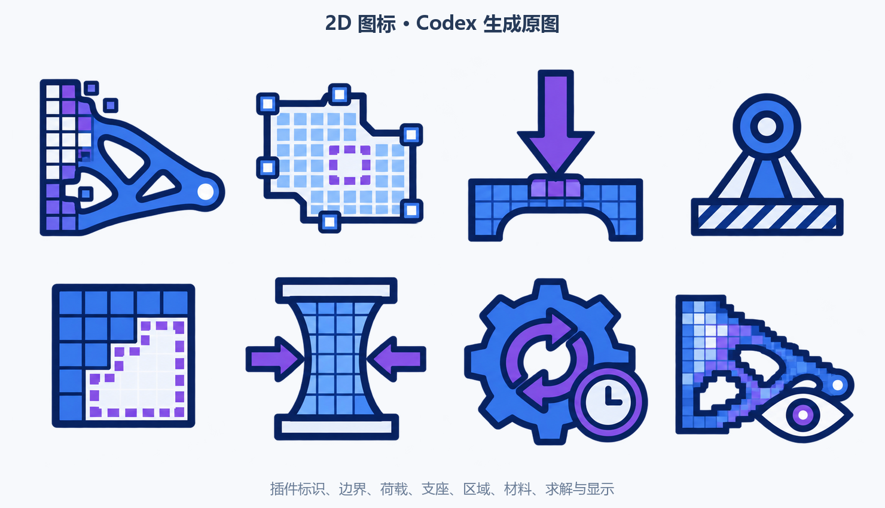

There was one requirement I only thought to add after the first round: **prepare the GH test files as well.** A pile of components would still leave me wiring them together and guessing the parameters. If the agent connects complete examples and adds notes, I can open a file and test it straight away.

### Compiling and opening the examples

The agent first inspected the repository and GH template, separated the condition components, SIMP solver and visualization, then wrote the code, compiled it automatically and ran checks. It finished by putting together a workflow report and the icon prompt. About an hour later, the 2D part was working, with test examples ready to open.

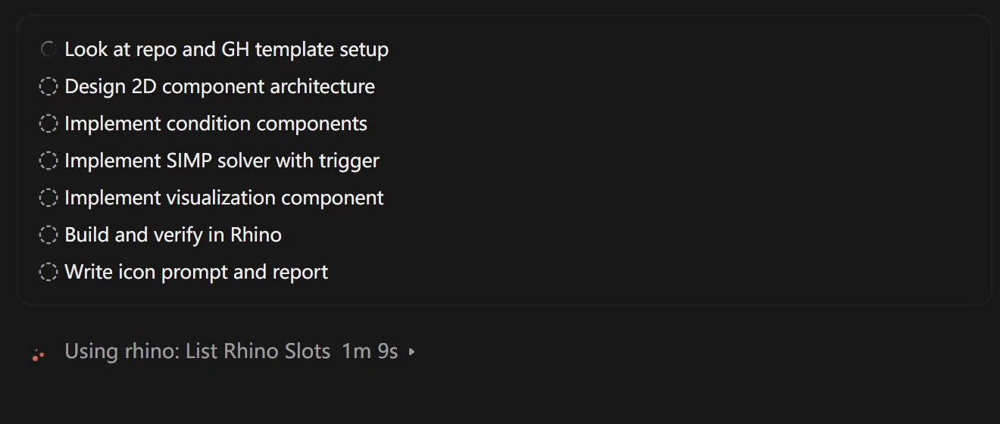

The agent writes and compiles the code automatically, producing a .gha file. To use it, Grasshopper needs to know where to find it. You can copy the plug-in into GH's **Libraries** folder manually, or enter **GrasshopperDeveloperSettings** in Rhino's command line and add the build output folder to Library Folders. GH searches these folders and loads the plug-ins when it starts, so you do not have to copy the file again after every build.

For this project, the output folder has the following path relative to the repository root. In the settings, select the corresponding full folder path on your computer, then restart Rhino:

<pre><code>src\Moyu\bin\Release\net7.0-windows</code></pre>

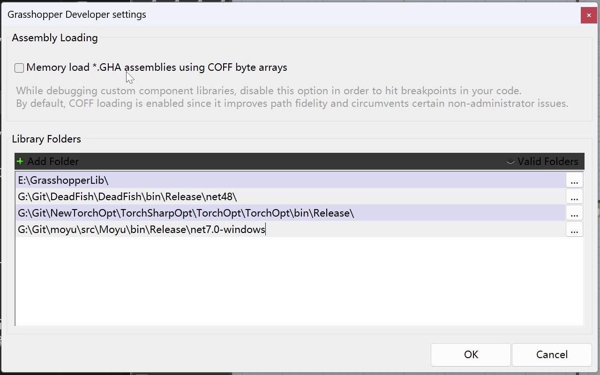

Here I have opened the GH test file. The agent created this file too.

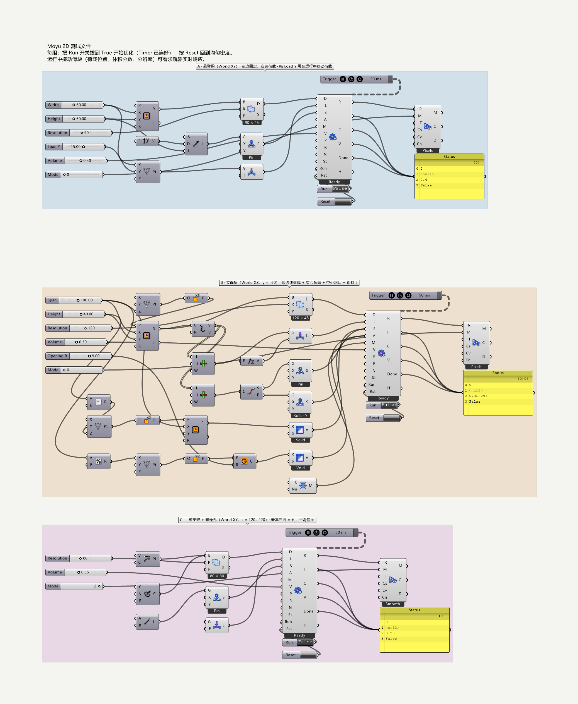

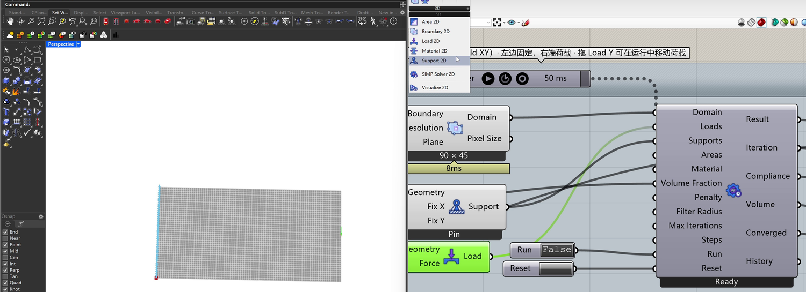

### 2D topology optimization results

Here is a simple way to think about topology optimization: give it a region where material is allowed, tell it where the supports and loads are, and specify how much material it may use. The solver then searches for a suitable material distribution.

The first example is a cantilever beam: a rectangular domain, fixed at one end and loaded at the other. Turn on Run, and the Trigger advances the iterations. You can also switch to manual operation and set Steps to 1 to inspect one step at a time. It starts with a uniform field of gray pixels. Gradually, the material concentrates into a few clearer paths.

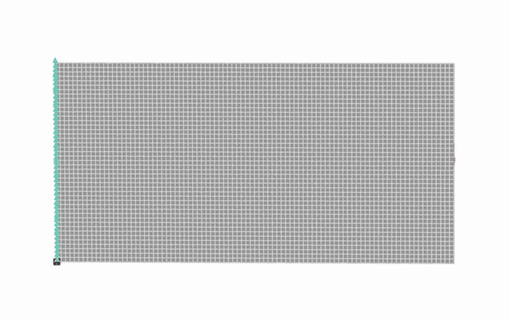

The second example adds a hole, preserved regions and different supports: a pin on one side and a roller on the other. Area lets you specify where material must remain and where it is not allowed. With a hole in the middle, the material reorganizes around it, forming branching paths above and a tie below.

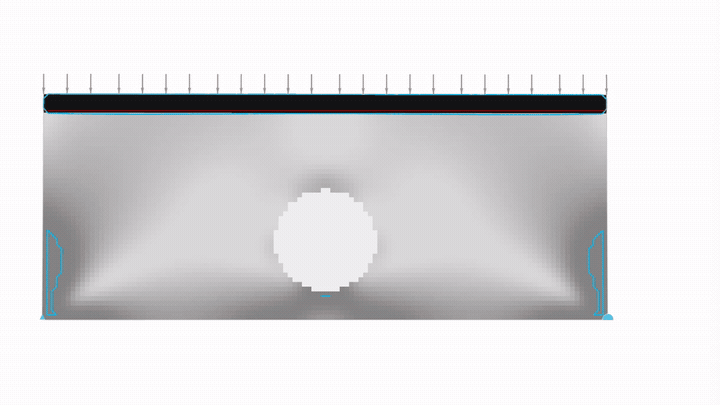

The third example is an irregular L-shaped bracket with a bolt hole. Again, I define the boundary, supports and loads, then watch the optimization. It can extract outline curves as well as display colored pixels, so I can create surfaces, extrude them and bring the result back into my own modeling workflow. A tool like this is useful for exploring mechanical parts or structural concepts.

.")

I was honestly amazed by the overall result of this round. In about an hour of development, AI had implemented the whole 2D part and prepared some very representative test examples. It is remarkable how much it could work out.

### 3D topology optimization: the same workflow, from pixels to voxels

Once the 2D version worked, I asked it to expand to 3D, keeping the conditions → Solver → visualization structure and preparing 3D test files and icons as well. This time, the design domain is a closed solid, and the material is represented by voxels rather than pixels.

The process was the same: ask the agent to develop the components, then generate their icons and test files.

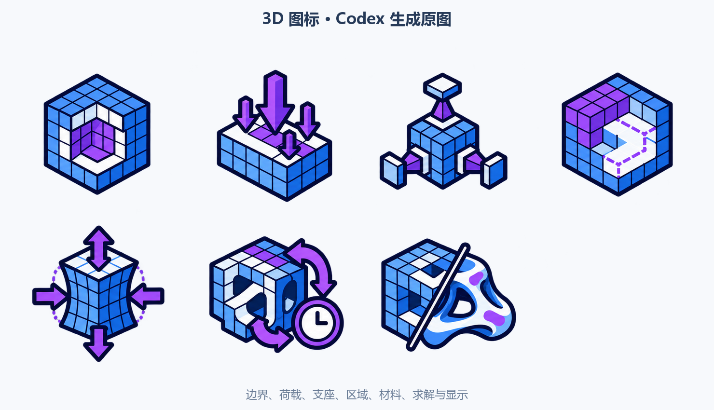

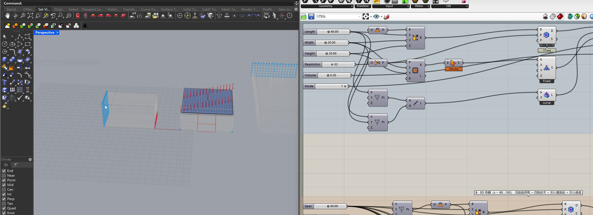

The agent gave me three examples again. The first is a 3D cantilever beam. Here is the optimization process, with the structure gradually taking shape.

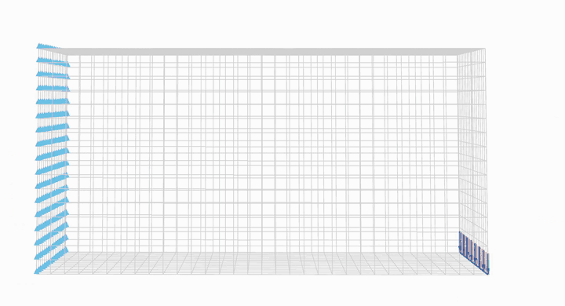

The second example optimizes the supports of a table. I specify the parts to preserve and let it optimize the rest. The status shows that this example converged after 35 iterations, leaving these tree-like supports.

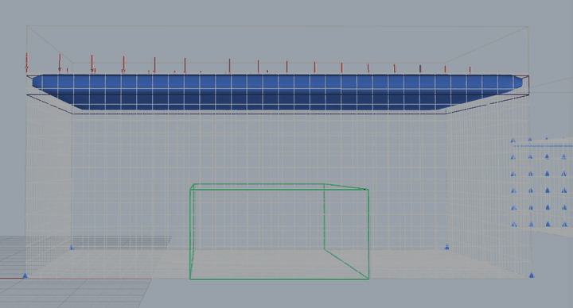

The L-shaped bracket works too. Increasing Resolution gives a finer result, but also makes the computation slower. At this stage, the plug-in is suitable for learning and concept exploration; real engineering applications still need dedicated analysis and verification. Of course, this was only the first development round. Getting this far already felt impressive. I wonder how long it would have taken to write it all by hand.

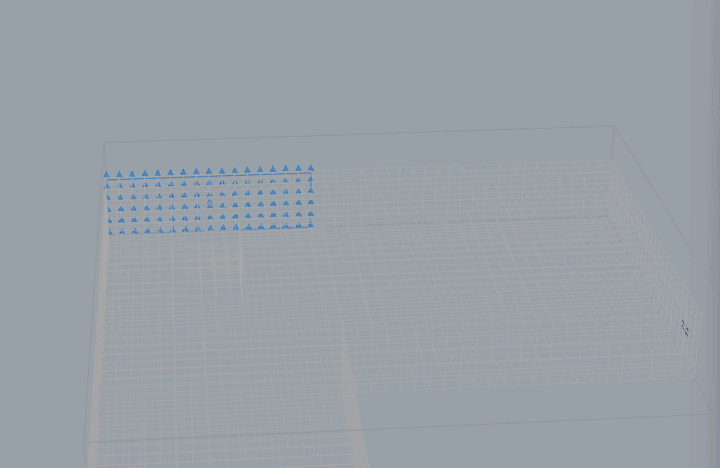

## Next, some games for taking a break in Rhino

Topology optimization was a fairly serious request. Next, I wanted to try something more personal and a bit more imaginative: games for slacking off inside Rhino.

For the first game, I thought of a 3D version of Tetris. I gave it a few core requirements: include a default set of blocks, but let users draw their own voxel Units; clear a layer and score points when it is full; use keyboard controls; and, most importantly, include a boss key that switches to a screen that looks like an architectural massing study. I left the remaining details for the agent to plan, as long as it made the game fun.

::: prompt The game prompt I actually used (full original)
现在我做一些在rhino里摸鱼的游戏 这些游戏都是以GH plug-in形式存在 也就说在moyu下再多开几个categories来做 第一个我想做的游戏是3D体素消除游戏 类似于俄罗斯方块 不过是3d版本 交互方式也许是 系统会自带一些默认的体素块 类似于平面的俄罗斯方块 L型 I型 之类的 但是用户也可以自己画一些由标准voxel堆砌出来的体素unit 反正每次每一层堆满就消除 基本原理还是和俄罗斯方块相同 也需要计分 最好是用键盘在操作移动 你计划一下 最重要的是这是一个摸鱼时间玩的游戏 所以要有老板键 可以快速切换成假装在做massing 形体研究的状态 具体细节你来安排 但是要有趣好玩
:::

According to the development record, the agent took about **1 hour and 13 minutes** to get from the initial idea to a playable first version: roughly 31 minutes for the proposal and 42 minutes to develop the playable v1. These figures cover the agent's execution stages. They do not include all the time I spent reviewing the results, playing the game and thinking about what to try next.

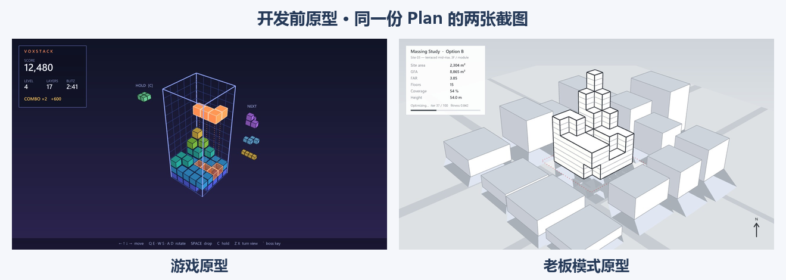

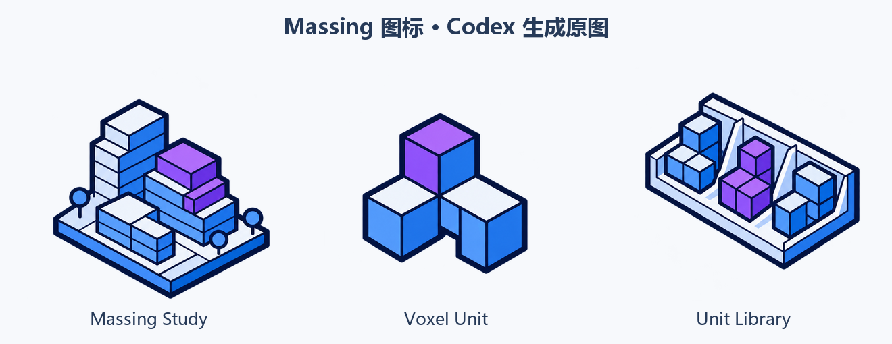

In the first proper playtest, I could already rotate and drop blocks and clear layers. At first, I found the 3D rotation a little complicated and the falling speed a little fast. It took me a while to get used to it and clear a layer. I kept refining the interface and controls afterward. Alongside the keyboard controls, it now has the Gumball Rhino users will recognize: drag a ring to rotate the block.

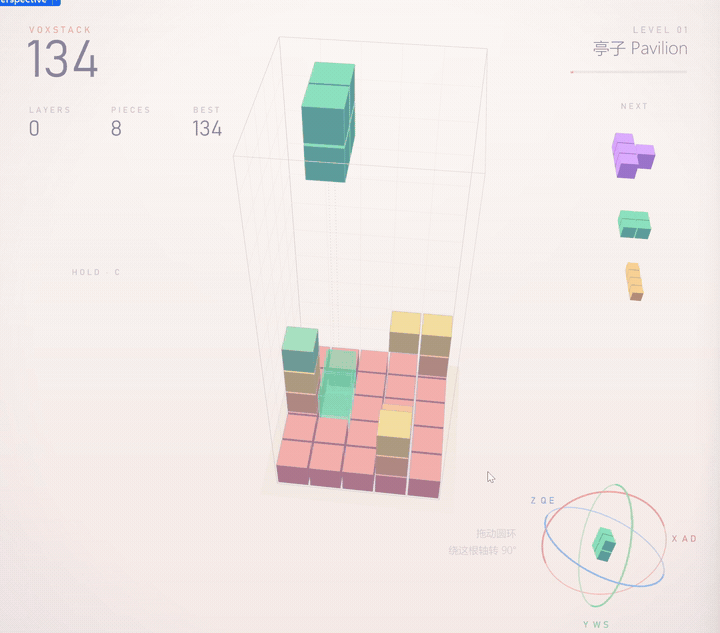

You can also add custom Units. Draw your own massing block, connect it to Voxel Unit and Unit Library, and it becomes part of the block library.

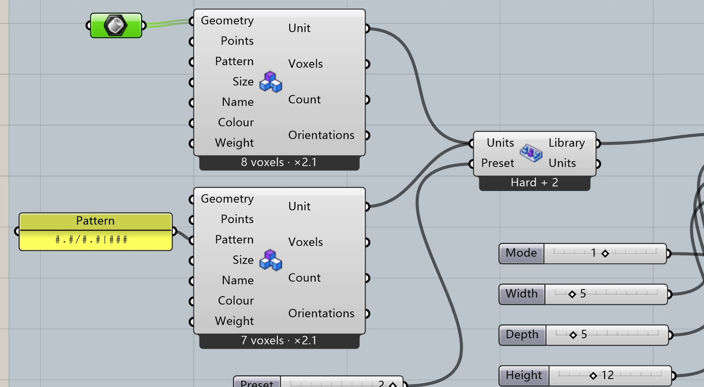

Press the boss key, **\`**—the key below Esc and to the left of 1—and the game switches to a massing-study screen, making it look as if I am still hard at work. Press it again to return to the game. All four games use this idea, each with its own work screen. These screens are part of the game design too.

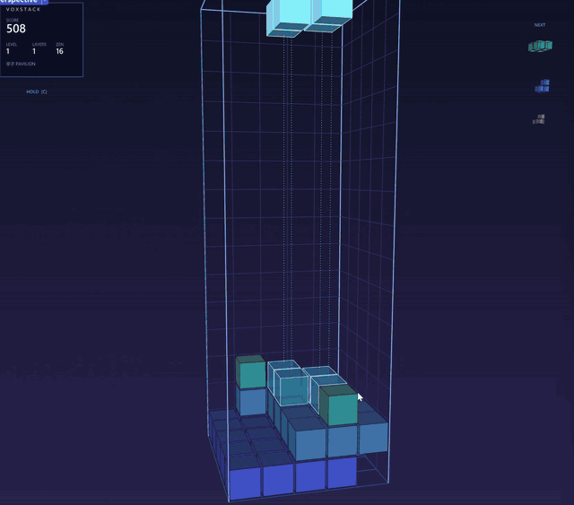

### Adding three more games

Over the next few days, I added three more in bits of spare time. They all run in the Rhino viewport, and each has its own “work screen.”

### Serpentine: Snake on a surface

The default terrain is undulating, but you can also connect your own Surface. Different fruits have different scores, with bonuses for eating them in succession and speed increases along the way. Press C to switch between a first-person follow view and a free view of the whole terrain.

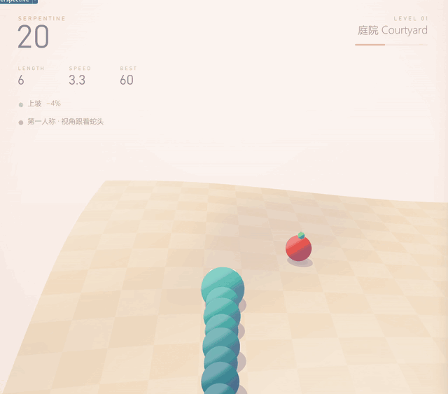

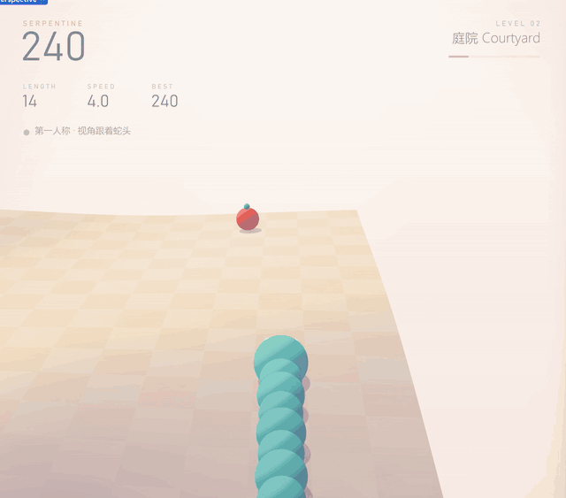

Press the boss key, and the game becomes a landscape study with terrain, paths, trees and analysis diagrams.

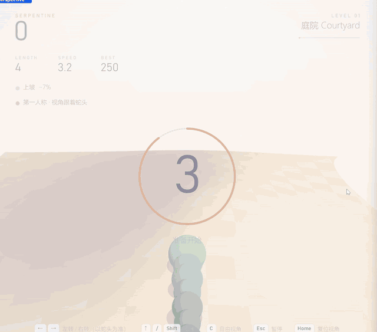

### Rebound: brick-breaking in a facade

This is my favorite of the four. It is easy to pick up and satisfying to play. Use the arrow keys or mouse to control the paddle, and Space to launch the ball. Power-ups drop as you play, including multiball, piercing and slow motion. The brick wall also relates to facade divisions, so boss mode turns it into a facade study. You can customize the brick layout too.

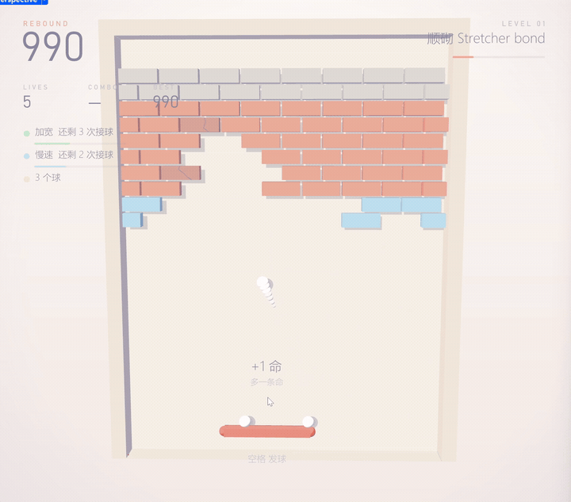

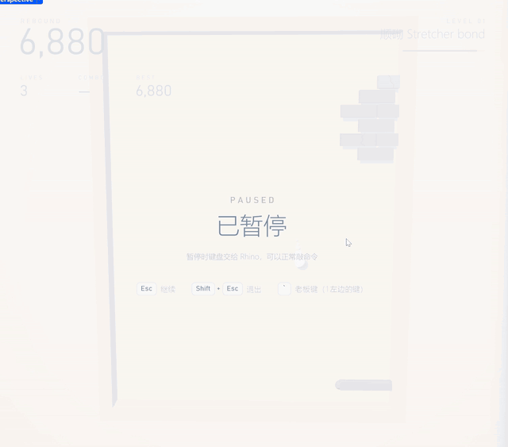

### Swift: flying through an architectural section

The last game is similar to Flappy Bird. Press Space or the left mouse button to flap through openings in an architectural section. I had already lowered the starting difficulty a little, but I still died pretty quickly in this playtest. The obstacle parameters are adjustable too. Press the boss key, and it switches to lighting and airflow diagrams of the section.

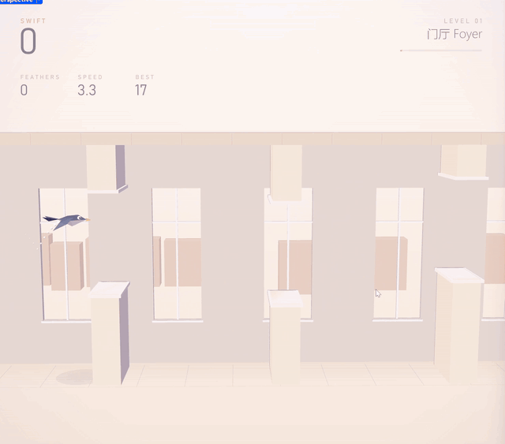

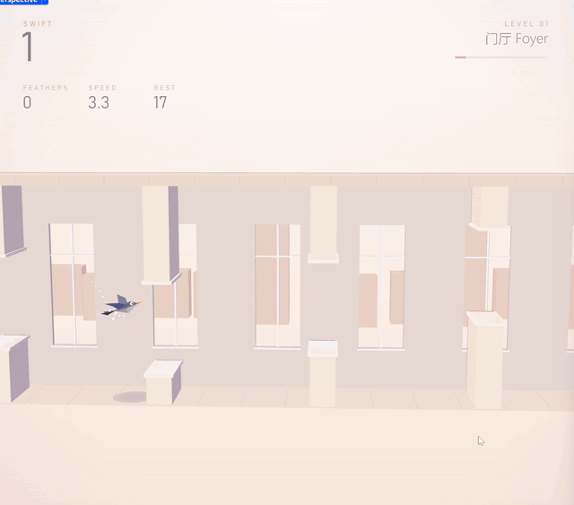

## Automated publishing

Once it was ready, I asked the agent to help publish the plug-in to **food4Rhino** and Rhino's **PackageManager**. You can search for it and install it yourself. The version demonstrated here is 1.0.1, and the food4Rhino link is at the end of the article.

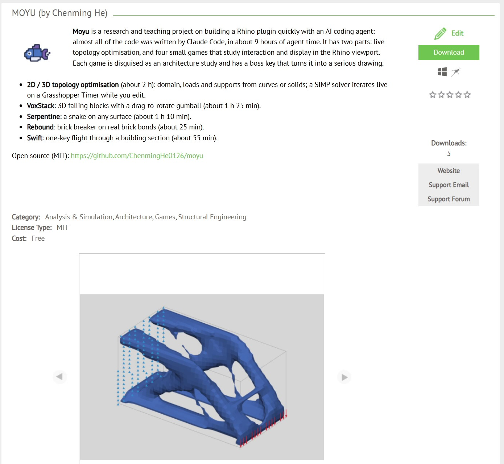

Enter **\_PackageManager** in Rhino's command line, search for **moyu**, install it, then restart Rhino.

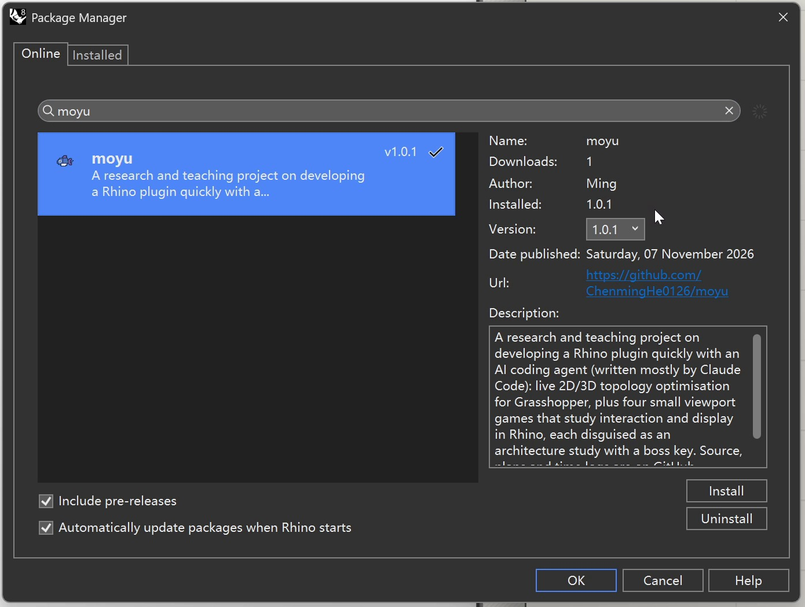

After installation, find the **Examples** component and choose an example directly from its panel. There is no need to dig through system folders for the GH files. The game components also have Run/Stop controls underneath, so one click starts or ends a game.

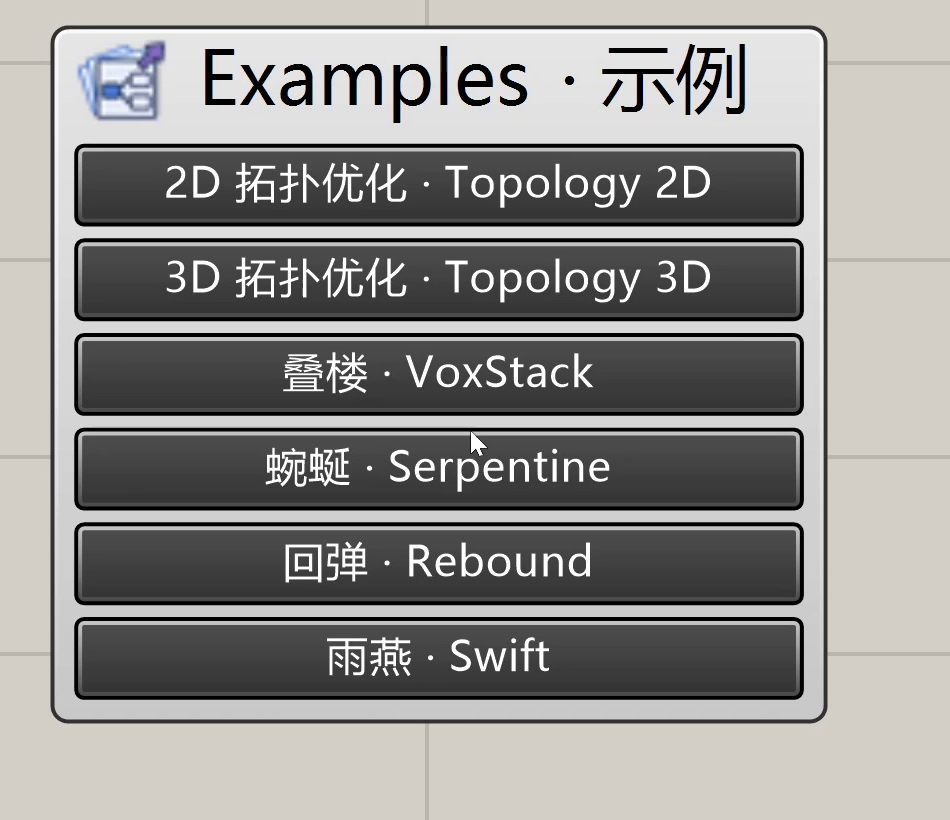

If you want to look at the source, the code, documentation and development records are all on GitHub. That link is at the end too.

Overall, the first version took about 9 hours of development, followed by around 3 hours of updates. I let AI work on it during spare time spread across several days. These figures mainly track the agent's execution time.

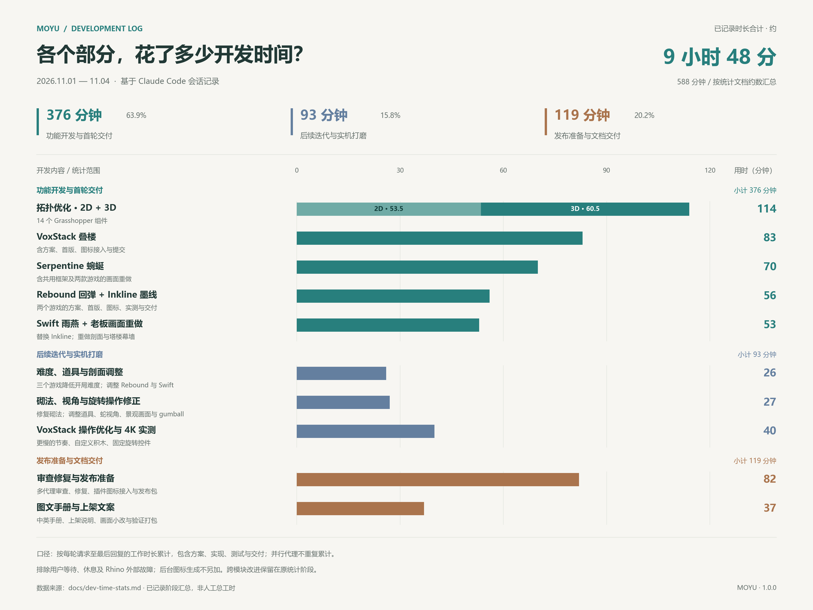

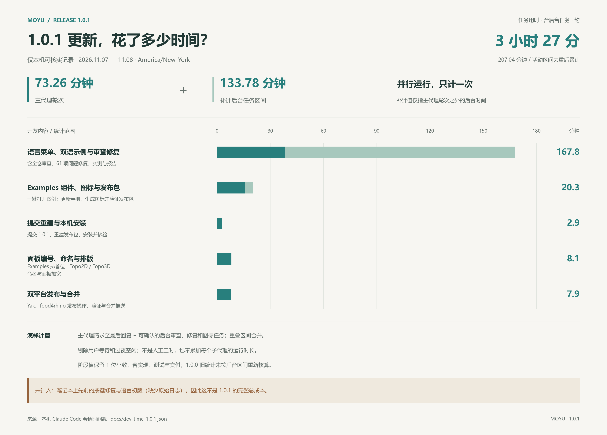

My strongest feeling from this project is that we may all move toward a product-manager role. As designers, we can put more energy into spotting problems, describing the behavior we want and judging the results. Work is full of small, repetitive annoyances. In the past, we might have kept doing them by hand because a dedicated plug-in did not seem worth writing. Now, we can give the request to an agent, get a working prototype, try it and keep improving it.

That is all for this one. If you enjoyed it, please give it a like and share it around. Thanks!

### Links

- [Moyu on food4Rhino](https://www.food4rhino.com/en/app/moyu?lang=en)
- [Moyu on GitHub: source code, installation and documentation](https://github.com/ChenmingHe0126/moyu)
- [Development time and how it was counted](https://github.com/ChenmingHe0126/moyu/blob/main/docs/dev-time-stats.md)
- [If you cannot access GitHub, download from Baidu Netdisk (extraction code: niwy)](https://pan.baidu.com/s/1evMjFc-IYL9A-HZ0QsjQww)
