嗨喽朋友们大家好，上次分享了用 AI 加 Rhino MCP，直接在 Rhino 里建模提升效率。其实 AI 更加强大，我们完全可以使用 Agent 来帮我们开发定制化的 GH 或者 RH 插件，满足日常工作中的功能需求。

这次就分享一下，我是怎么一行代码没写、一张图没做，纯许愿式、聊天式地用 Agent 开发了一个小插件 **Moyu（摸鱼）**。这个插件一半是正经的 2D、3D 拓扑优化，另一半是在 Rhino 里玩的摸鱼小游戏，还带老板键，可以瞬间切换游戏和工作界面。开发途中，代码、测试、图标、文档以及发布全都交给 AI，下面我就分享一下过程。

## 拓扑优化

### 前期 Prompt

我先建了一个空的 GitHub 仓库，在 Claude Code 里选中本地项目文件夹。准备的环境是 Windows 上的 Rhino 8 和 Grasshopper，我预期从 Rhino 的 GH 模板开始开发；因为之前接过 Rhino MCP，所以 Agent 也可以方便地打开软件、操作和检查结果。这次主要用的模型是 **Opus 5.5 Extra**。

我之前写过类似的拓扑优化插件，所以大致知道自己需要什么。这次特意让它独立实现，先从 2D pixel 开始，再往 3D voxel 扩展。下面是我当时已经提交的需求。原话其实很口语，也有拼写错误，但是 AI 还是很擅长整理信息的。

::: prompt 当时实际输入的 Prompt（完整原文，保留拼写）
我想你帮我使用rhino GH开发模版 写一个运算拓扑优化的插件 先从2D pixel工作流开始 2D放在一个category里 有Load support boundary area matrerial之类的限制conditionde components 然后所有这些condition 都被放入一个solver里进行运算 这个solver是被trigger进行驱动的 所有的comoponent先不画icons 你到时候整理一个prompt 我用来在gpt里创建icons （不要参考我的论文torchsharp）solver之后 再加一个visuliaztion的component来显示结果
:::

这段需求里，最有用的是把整个工作流拆出来：**Boundary 定义设计区域，Load 和 Support 放荷载与支撑，Area 指定保留或挖空的区域，Material 放材料参数；这些条件交给 Solver 运算，再由 Visualization 显示结果。** Solver 用 Trigger 驱动，方便一轮一轮地观察变化。

第一轮先把功能做通，icons 后面单独处理。我让 Claude Code 整理每个元件的用途，再交给 Codex 做图标。只让 Claude Code 说明元件功能和蓝白、蓝紫的色调，生成 Prompt，然后把 Prompt 喂给 Codex，让它自己设计。最后再让 Agent 切成 GH 要用的透明小图标，放进插件里。

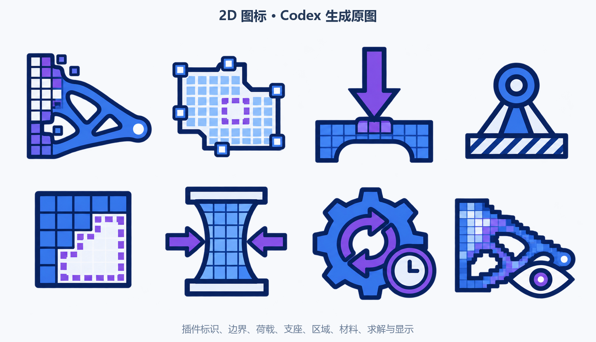

还有一个我做完第一轮才补上的要求：**把测试用的 GH 文件也做好。**光有一堆组件，我还得自己接线、猜参数；让它连好完整案例并写上注释，我打开后就能直接测试。

### 编译与打开案例文件

Agent 会先查看仓库和 GH 模板，拆分条件组件、SIMP 求解器和可视化，再写代码、自动编译、跑检查，最后整理工作流报告和图标 Prompt。前后大概一小时，2D 部分已经能用，测试案例也准备好了。

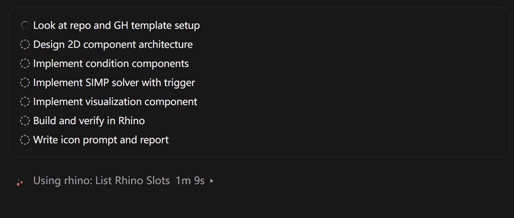

Agent 会自动写码、自动编译，生成 .gha。想使用这个文件，需要让 Grasshopper 找得到它。我们可以手动把插件复制到 GH 的 **Libraries** 目录下，也可以在 Rhino 命令行里输入 **GrasshopperDeveloperSettings**，把编译输出目录加到 Library Folders。GH 启动时会去这些目录里找插件并加载，就不用每次编译完都重新拷贝了。

本期项目的输出目录，相对于仓库根目录是下面这个路径。设置时要选你电脑上对应的完整目录，再重启 Rhino：

<pre><code>src\Moyu\bin\Release\net7.0-windows</code></pre>

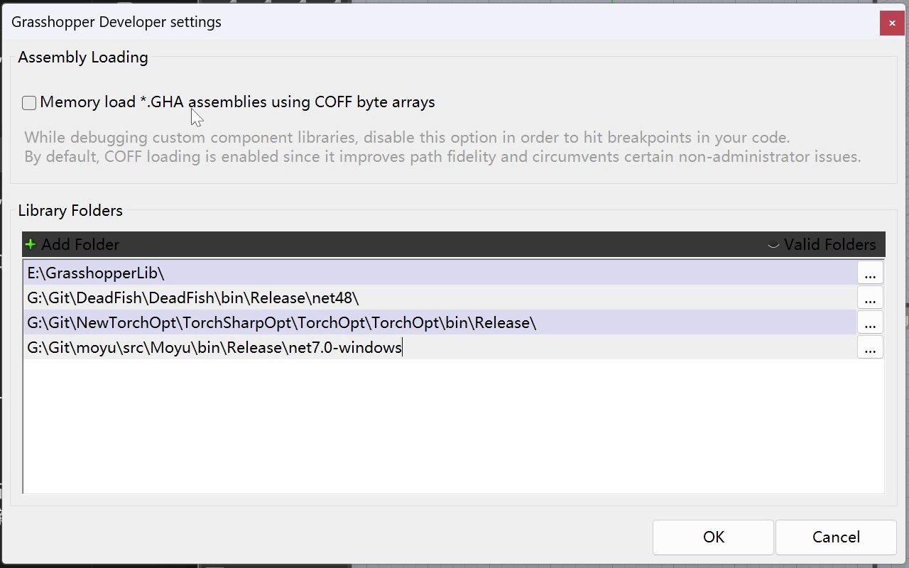

这里我已经打开了写好的 GH 测试文件，这个文件也是 Agent 自己写好的。

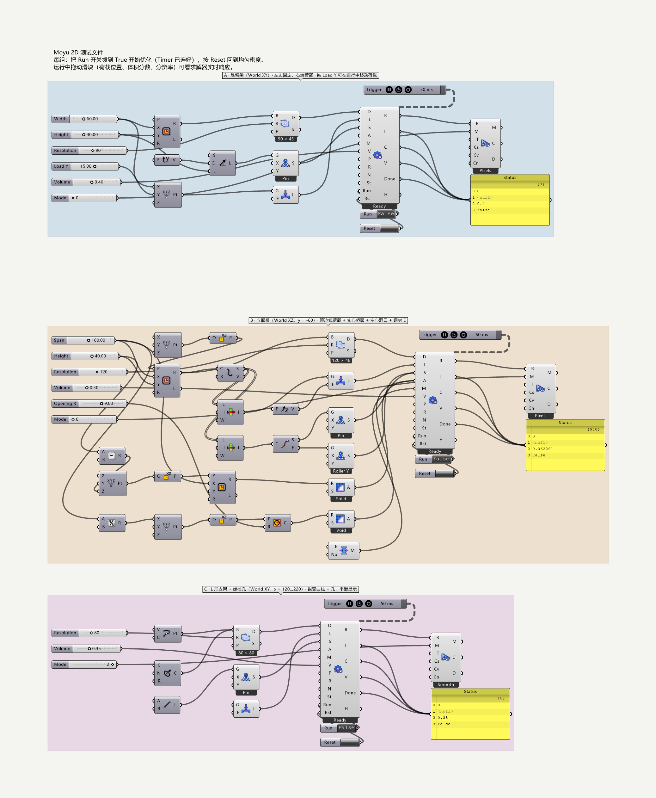

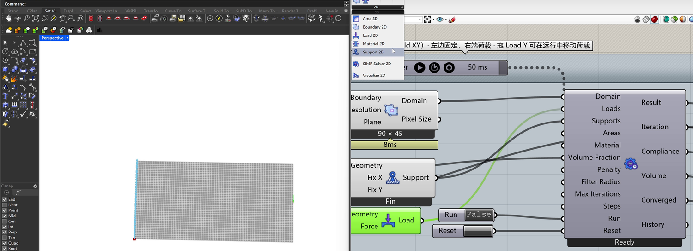

### 2D 拓扑优化结果

拓扑优化可以先这样理解：给定一个允许放材料的区域，再告诉它哪里固定、哪里受力，以及允许使用多少材料，让求解器寻找合适的材料分布。

第一个案例是悬臂梁：一块矩形区域，左端固定，另一端放荷载。把 Run 打开，它会随着 Trigger 推进迭代。也可以改成手动、把 Steps 设成 1，一次看一步。刚开始是均匀的灰色像素，随后能看见材料逐渐集中，形成几条比较清楚的路径。

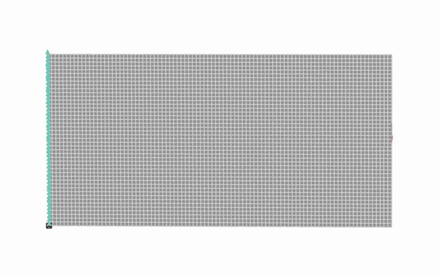

第二个案例加了孔洞、保留区和不同的支撑，一边是 pin，一边是 roller。Area 可以规定哪些地方必须留下，哪些地方不能长材料。中间有洞，结果就会绕着洞重新组织；上面长出类似树杈的分支，下面还有拉结。

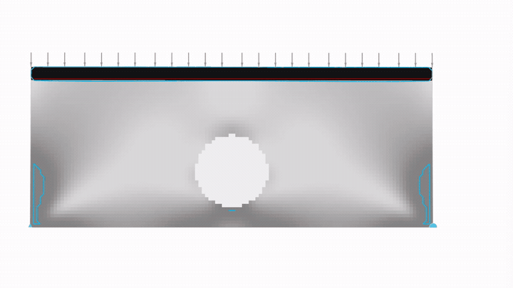

第三个是带螺栓孔的异形 L 支架。同样先给边界、支撑和荷载，再看优化结果。它不只输出彩色像素，也可以提取轮廓曲线，后面继续做面、挤出，接回自己的建模流程。这样的工具适合拿来做机械零件或结构概念的探索。

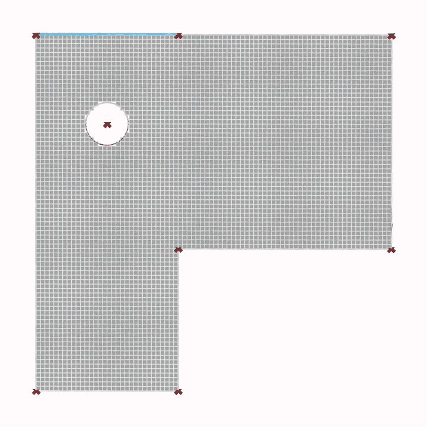

这一轮的整体结果，我看着确实很震撼。在大约一个小时的开发中，AI 不仅完整地写出了 2D 部分，还做了很有代表性的测试案例，这种智能程度让人感叹。

### 3D 拓扑优化：流程相同，pixel 换成 voxel

2D 跑通后，我再让它扩展到 3D，继续沿用条件 → Solver → 显示的结构，同时做好三维测试文件和图标。这一次设计域变成封闭的实体，材料也从 pixel 换成 voxel。

同样的过程，先让 Agent 开发，再生成 3D 元件的图标和测试文件。

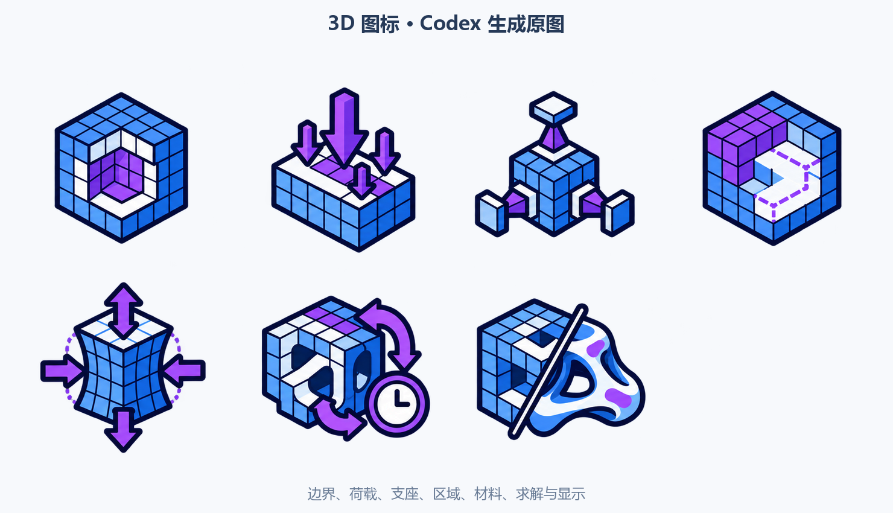

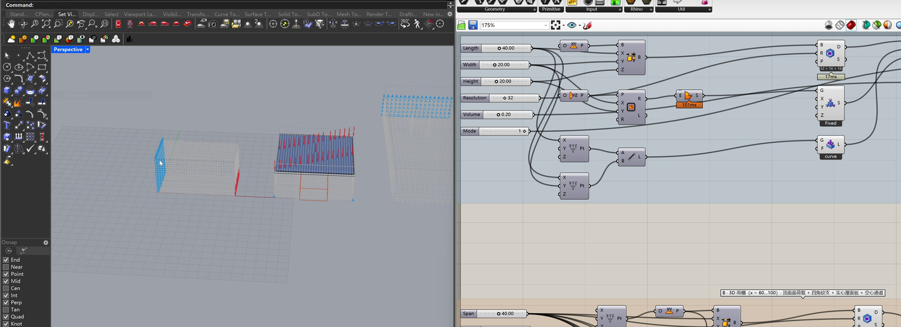

这里 Agent 也是照例给了三个例子。第一个是三维悬臂梁，优化效果如下，可以看到结构逐步显示出来。

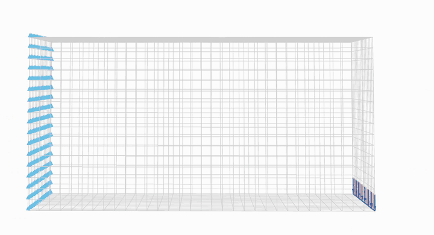

第二个案例是对桌子支撑的优化，指定要保留的部分，其他地方让它优化。状态里显示这一例跑到 35 轮收敛，最后留下了这样树状的支撑。

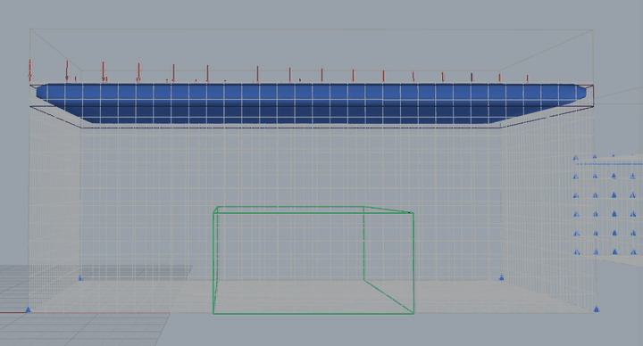

L 形支架也能跑。把 Resolution 提高，结果会更细，运算也会变慢。现在这套插件适合学习和概念探索，实际工程仍需要专门的分析与验证。当然，这里只是第一轮开发，已经达到这个程度，真是很厉害了。如果换成人手写开发，不知道要多久。

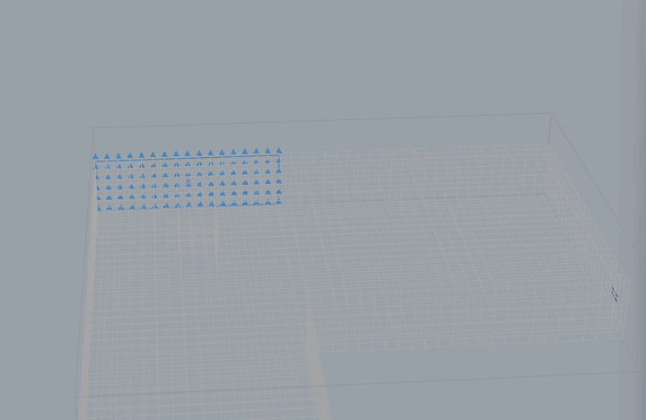

## 接下来，在 Rhino 做摸鱼游戏

拓扑优化是比较正经的需求。接下来我想试一个更定制、也更天马行空的需求：做一些在 Rhino 里玩的摸鱼游戏。

第一个游戏，我想到三维的俄罗斯方块。我交代了几个核心要求：默认有一套积木，也允许用户自己画体素 Unit；一层堆满就消掉、计分；用键盘操作；最重要的是，要有个老板键，按一下就切成看起来在研究建筑体块的界面。其他细节先让它规划，但要做得好玩。

::: prompt 当时实际输入的游戏 Prompt（完整原文）
现在我做一些在rhino里摸鱼的游戏 这些游戏都是以GH plug-in形式存在 也就说在moyu下再多开几个categories来做 第一个我想做的游戏是3D体素消除游戏 类似于俄罗斯方块 不过是3d版本 交互方式也许是 系统会自带一些默认的体素块 类似于平面的俄罗斯方块 L型 I型 之类的 但是用户也可以自己画一些由标准voxel堆砌出来的体素unit 反正每次每一层堆满就消除 基本原理还是和俄罗斯方块相同 也需要计分 最好是用键盘在操作移动 你计划一下 最重要的是这是一个摸鱼时间玩的游戏 所以要有老板键 可以快速切换成假装在做massing 形体研究的状态 具体细节你来安排 但是要有趣好玩
:::

按当时的开发记录，从提出想法到第一版能玩，Agent 用了约 **1 小时 13 分钟**：其中出方案约 31 分钟，开发到可玩的 v1 约 42 分钟。这里统计的是 Agent 的执行阶段，没有把我自己看结果、试玩和思考下一步的时间全算进去。

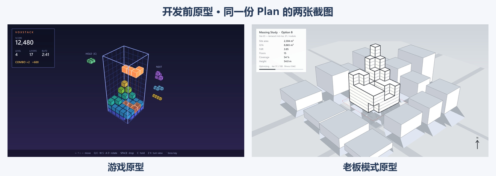

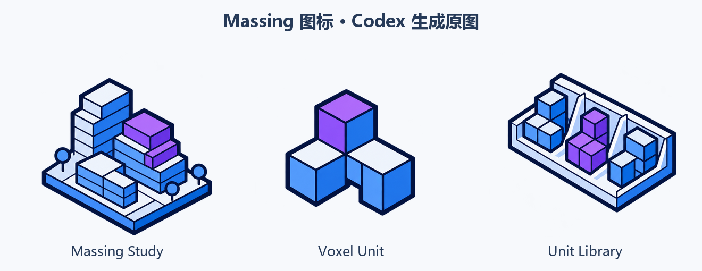

第一轮正式试玩已经能转积木、下落、消层。最开始我觉得三维旋转有点复杂，下落也偏快，熟悉一会儿才成功消掉一层。后来又继续改界面和操作，现在除了键盘，也加了 Rhino 用户熟悉的 Gumball，拖圆环就能旋转。

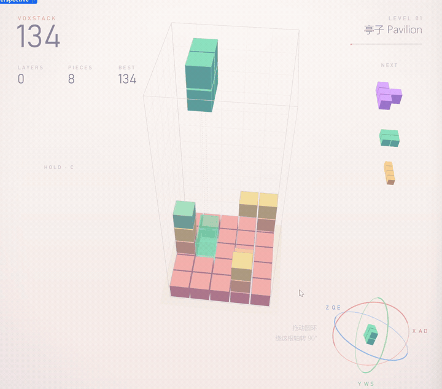

这个也可以接入自定义 Unit。自己画好体块，再接到 Voxel Unit 和 Unit Library，就可以把它加入积木库。

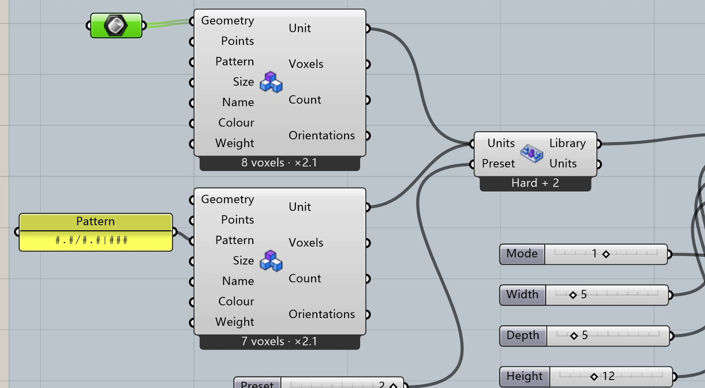

按下老板键 **\`**，也就是 Esc 下面、数字 1 左边的那个键，就会自动切换成体量研究界面，伪装成还在认真工作。再按一次回游戏。四款共用这个思路，只是对应的工作画面不同。这些界面本身也是游戏设计的一部分。

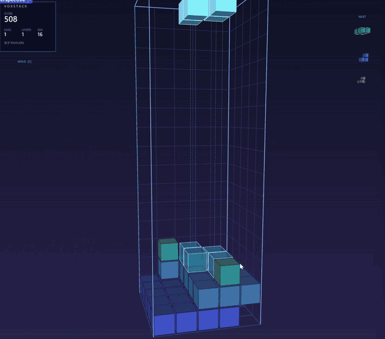

### 又加了三款游戏

后面几天断断续续，利用闲暇时间，我又继续加了三款。它们都在 Rhino 视口运行，也都有各自的“工作界面”。

### Serpentine 蜿蜒：曲面上的贪吃蛇

默认是起伏的地形，也可以接自己的 Surface。水果有不同分值，还能连吃加分、加速。按 C 可以切换第一人称跟随视角和看整个地形的自由视角。

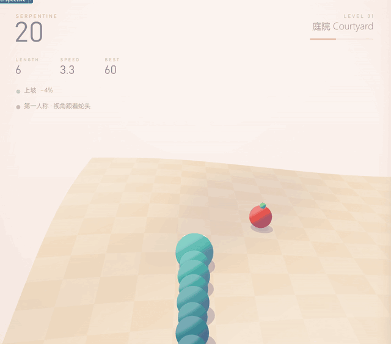

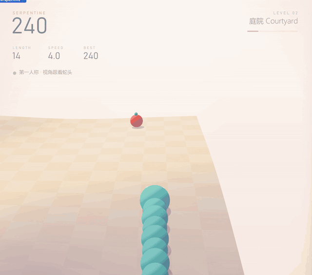

按下老板键，游戏切成景观研究：地形、步道、树和分析图。

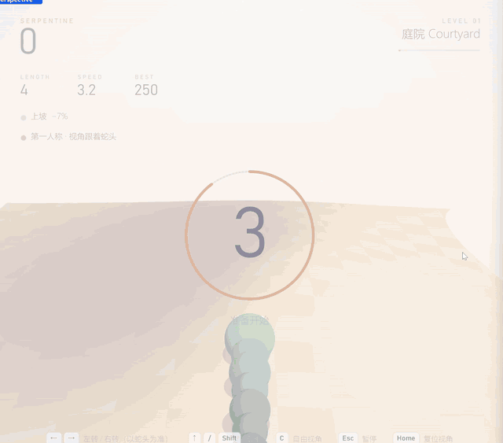

### Rebound 回弹：立面里的打砖块

这个是四款里我最喜欢的，上手简单，打起来很爽。方向键或鼠标控制挡板，空格发球；过程中会掉落多球、穿透、慢速等道具。砖墙也能和立面的分格联系起来，老板模式就变成立面研究。这个游戏也可以自定义砖块排布等。

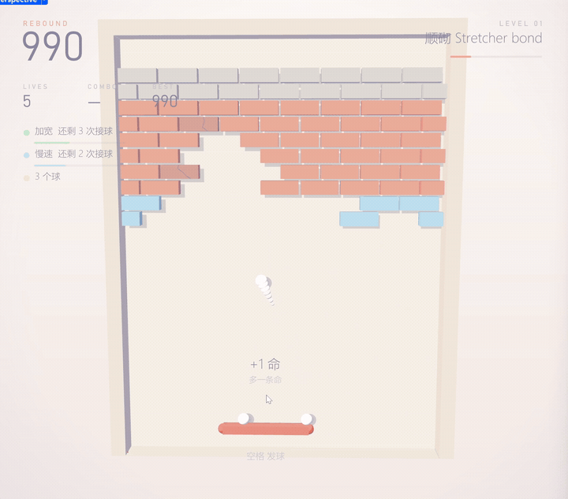

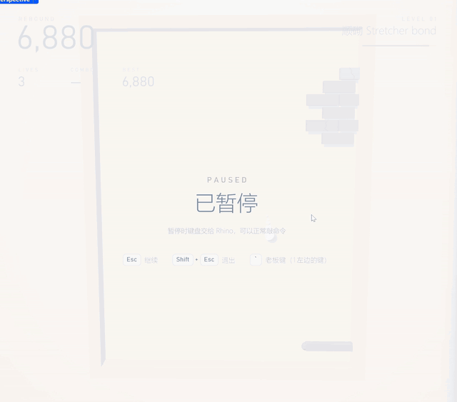

### Swift 雨燕：穿过建筑剖面

最后一个类似 Flappy Bird，空格或鼠标左键控制振翅，从建筑剖面的洞口穿过去。开头难度已经调低了一些，不过我这次试玩还是很快就挂了，障碍参数也可以改。按老板键，则切成剖面的光照、气流示意。

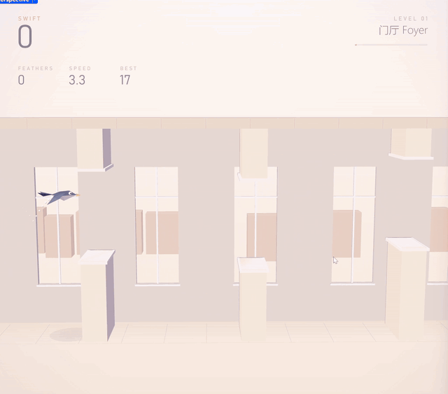

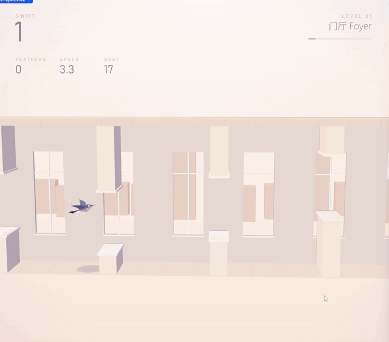

## 自动发布

做完之后，我让 Agent 帮我把插件发布到 **food4Rhino** 和 Rhino 的 **PackageManager**。大家可以自行搜索安装，本期演示的是 1.0.1 版本。food4Rhino 页面链接也放在文末。

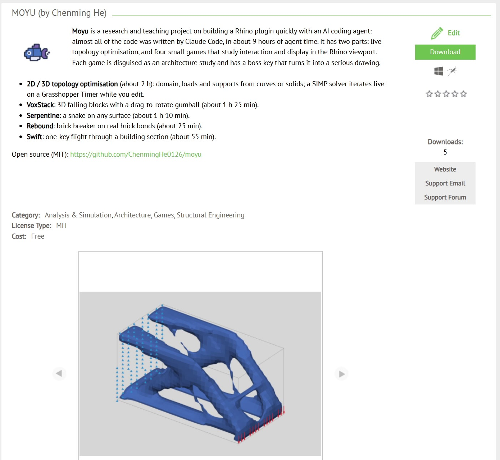

在 Rhino 命令行输入 **\_PackageManager**，搜索 **moyu**，安装后重启 Rhino。

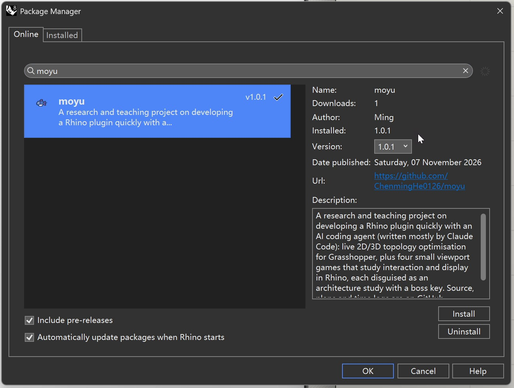

安装完成之后，找到 **Examples** 组件，直接在面板里选案例，就不用去系统目录深处找 GH 文件。游戏组件下方也有 Run／Stop，点一下就能开始或结束。

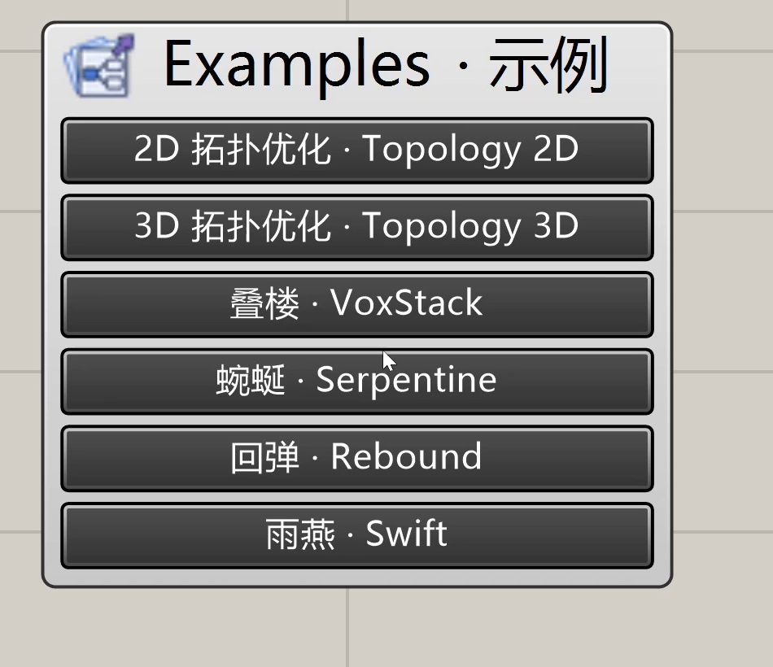

另外，想看源码的话，代码、文档和开发记录也都放在 GitHub，链接同样附在文末。

时间上，整体第一版开发约 9 小时，后续更新约 3 小时，都是分散在几天的业余时间里让 AI 跑。这里主要记录的是 Agent 执行的时间。

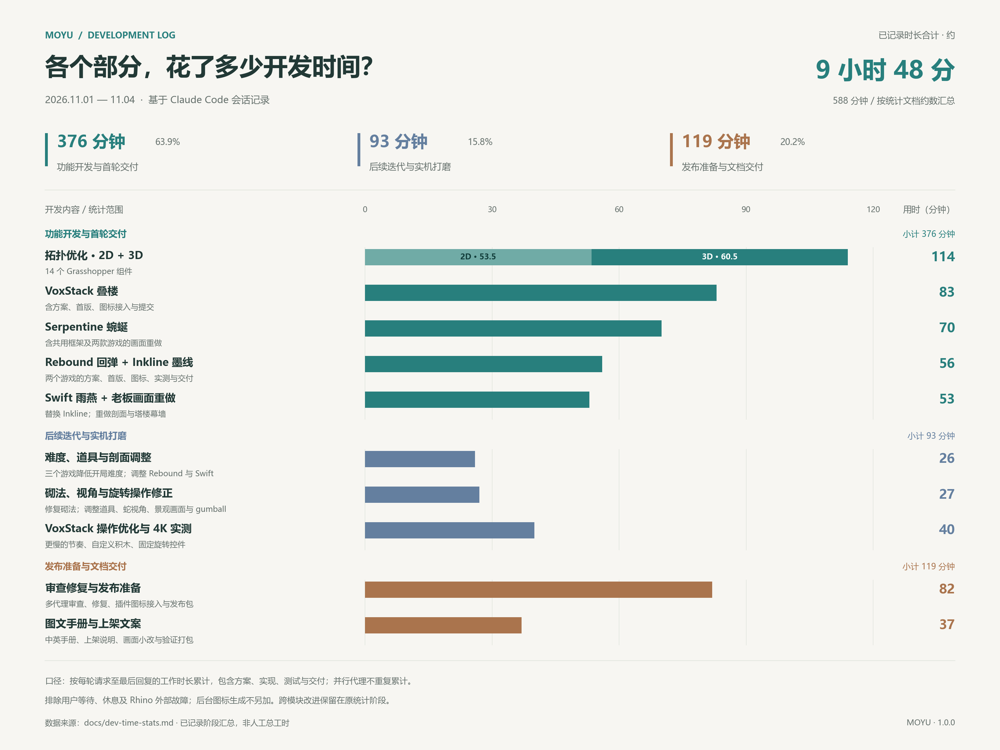

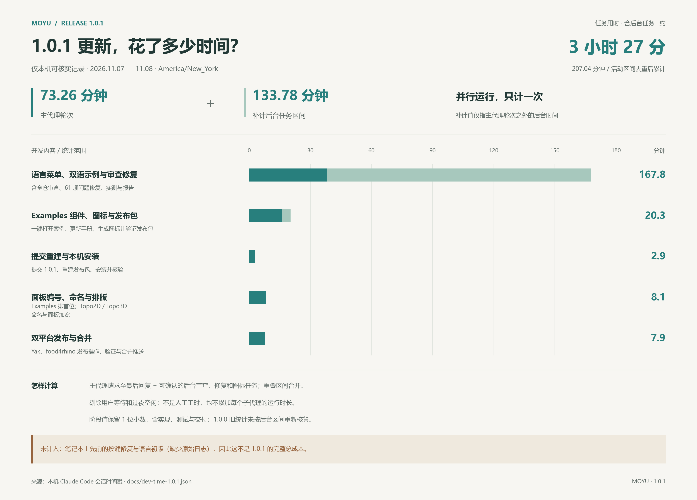

我这次最强烈的感受是，也许以后大家都要向产品经理的角色转型。设计师可以把更多精力放在发现问题、描述想要的行为，以及判断结果上。工作里总有一些反复操作的小麻烦，以前可能因为不值得专门写一个插件，就一直手动做。现在可以先把需求交给 Agent，做一个能跑的原型，试过以后再继续改。

本期分享就到这里。如果你觉得不错的话，请给我点赞、多多分享吧！感谢！

### 链接

- [Moyu：food4Rhino 页面](https://www.food4rhino.com/en/app/moyu?lang=en)
- [Moyu：GitHub 源码、安装说明与使用文档](https://github.com/ChenmingHe0126/moyu)
- [开发耗时与统计口径](https://github.com/ChenmingHe0126/moyu/blob/main/docs/dev-time-stats.md)
- [如果无法科学上网，百度网盘下载（提取码：niwy）](https://pan.baidu.com/s/1evMjFc-IYL9A-HZ0QsjQww)
