Hello, friends! A lot has changed. My last update here was six years ago. When I started this WeChat Official Account, I was an undergrad. Now I'm close to finishing my PhD. Along the way I did share some things, but I felt video was more direct, so I posted a series of videos on Bilibili about using C# in Rhino. Now I'm picking the WeChat Official Account back up to write more blog posts, but the main focus will shift from Grasshopper (GH) to coding + AI.

The posts here will mostly be condensed, illustrated versions of each of my upcoming videos. I'll lean on the almighty power of AI to write them quickly, so some parts will inevitably have a bit of that stiff AI tone. But for the sake of spreading knowledge quickly, I think that's acceptable.

Without further ado, this time I want to share how to install Rhino MCP and let an AI agent do the modeling for us in Rhino. First how to install it, then a few examples to see how it does. I tried several: modeling a kettle from a photo, making the cow from *Niu Lai* (《牛来》), generating a spiral staircase, and using Grasshopper to turn the staircase into a model with adjustable parameters. I tried AIs from both China and abroad, including Claude Code, Codex, GLM and DeepSeek, and at the end I also messed around with a local model (not very successful; local deployment still has a long way to go). You can compare the results yourselves.

There's a lot of content, so I've split it into two parts. Part 1 covers installation and a few examples with Claude; Part 2 looks at other AIs. If you've already installed it, you can skip straight to section 3 for the kettle.

## 01 First, what MCP does

MCP stands for Model Context Protocol. It's really a set of communication rules that lets an AI agent talk to other programs, and through that, get them to do things. This Rhino workflow starts a local server, and the AI and Rhino talk to each other through a local address, much like visiting a website. If your copy of Rhino is cracked by blocking it with a firewall, this feature may be restricted. Once the AI agent and Rhino are connected through the MCP bridge, the agent can call Rhino's tools directly, read the current model, run modeling operations, and even switch views, take screenshots, and keep revising based on the results. We describe what we want in the chat window, and the model gets generated automatically in Rhino, sparing everyone the pain of modeling.

::: note
Three things are easy to mix up here: the base large language **model** understands the request, the AI **client** is where we give instructions and where tools get called, and **Rhino** does the modeling. MCP is the bridge that connects them.
:::

Get **Rhino 8** ready first. Here I'll demo with Fable 5 / 5.1 in **Claude Code**, and for some tasks I also turned on Ultracode's multi-agent feature, which means letting several AIs split up the work. All the times below were measured with this setup.

## 02 Installation and connection

**Step 1: install the Rhino plugin.**  
In the Rhino command line, type **PackageManager**, search for Rhino-MCP, and find **Rhino-MCP-Platform**. Note that the search results include plugins with very similar names, so look for **made by McNeel** in the description. Click Install, and restart Rhino once it's installed.

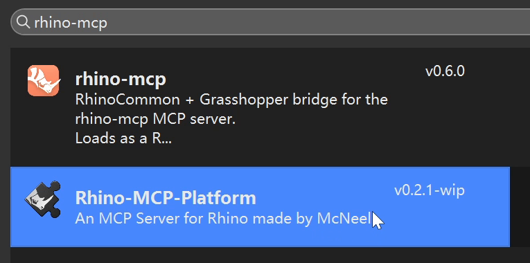

**Step 2: connect the AI client.**  
In the Rhino command line, type **MCPConnect**. The window lists the clients it detects; click the matching Install button to configure one. In the image below, Claude Code already shows Installed, which means it's set up; Codex hasn't been installed yet.

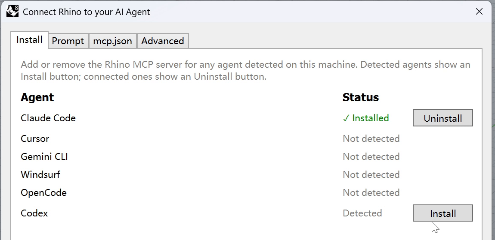

If your interface looks different and there's no Install page, switch to Prompt, copy the configuration prompt it generates, and send it to the AI client you want to use. Have the client configure itself following that prompt, then restart the client. Where this option lives may change in future versions; I've linked the official instructions at the end.

**Step 3: start the service and test the connection.**  
Back in Rhino, type **MCPStart** in the command line. The Log above will show which local port the MCP Server started on. Send the connection info to the AI and have it check:

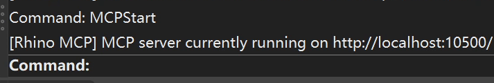

::: prompt The prompt I used
MCP server currently running on http://localhost:10500/ please help me connect to rhino mcp and check the connection
:::

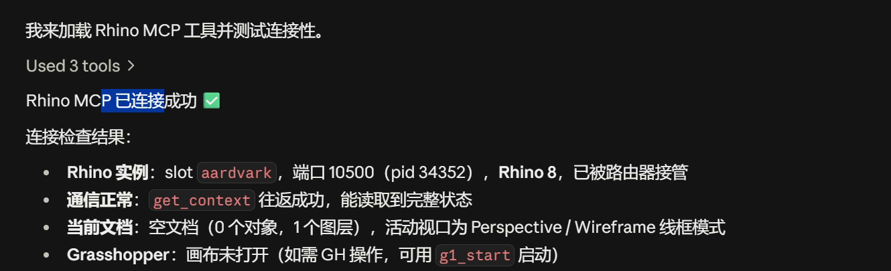

Once connected, you can have it make something small as a test. You can also type **MCPHelp** to open the official docs for instructions and updates (you might need a VPN to get past the Great Firewall).

## 03 First example: modeling a kettle from a photo

Let's start with a kettle. I sent Claude Code the photo of the glass electric kettle from McNeel's official examples, and the request was just one line:

::: prompt The prompt I used
Model this image in Rhino
:::

Here's what it looks like in practice. Rhino is open on the left, and Claude's chat and task window is on the right. On the right you can see what it's analyzing and how it plans to build; on the left you can see the model take shape step by step. No copying code back and forth: it calls the modeling operations itself.

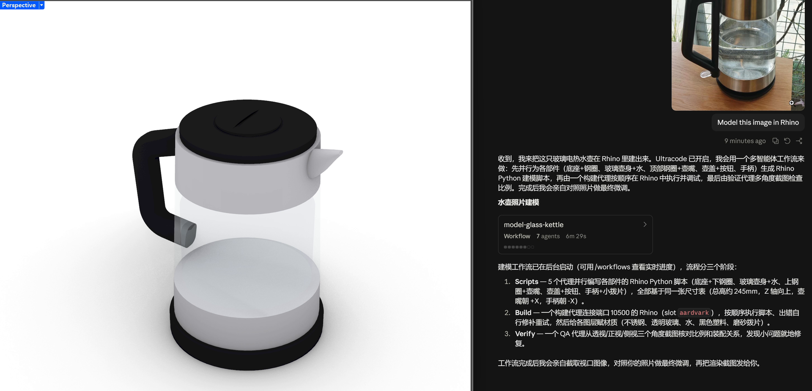

This round had the multi-agent feature on. It first looked at the reference image and broke the kettle into parts: body, base, top, handle and so on. Then it wrote a Rhino Python script for each, ran them to generate the geometry, and finally took screenshots from a few angles to check. While it's running, you can also look at the task list to see whether it misunderstood anything from the start.

::: note
From sending the request until the complete kettle body was ready to look at, I waited about **8–9 minutes**. Including the view changes, display tweaks and checks afterwards, it took about **14 minutes** in total. That's the time for my whole round, including waiting and checking.
:::

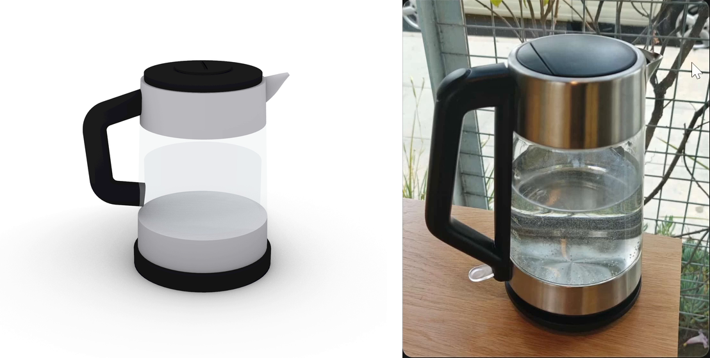

From a distance it's not bad: the glass body, black handle and base are all there. But compare it closely with the original and the handle's width at the top and bottom is wrong, and the button and some local proportions are off too. Still, modeling completely hands-free is a lot of fun.

You can try to keep revising it; just describe what you want and what's wrong clearly. If you only say "it doesn't look like it," it will have a hard time knowing what you want changed. The model is already split into layers, so if some parts are faster to fix by hand, you can carry on yourself.

## 04 Niu Lai: a lot of fiddling, mediocre results

After the kettle, I wanted to have some fun, so I tried something less regular. *Niu Lai* happened to be really popular at the time, so I gave it a reference image of the cow character and asked it to model from that. In the first version, the head, horns and body were all there, but it was basically spheres, cylinders and other basic geometry stuck together. Compared with the reference, the form was still pretty far off.

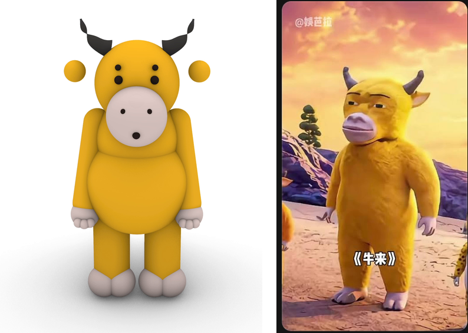

Next I asked it to use SubD, hoping to make the shape softer. After that I revised it for several more rounds, working on the head, muzzle, eyes, eyebrows, arms and belly. It was better than the first version, but still didn't quite get there, and the character's expression wasn't right either. This shows the model's ability is still limited; maybe Codex would do better.

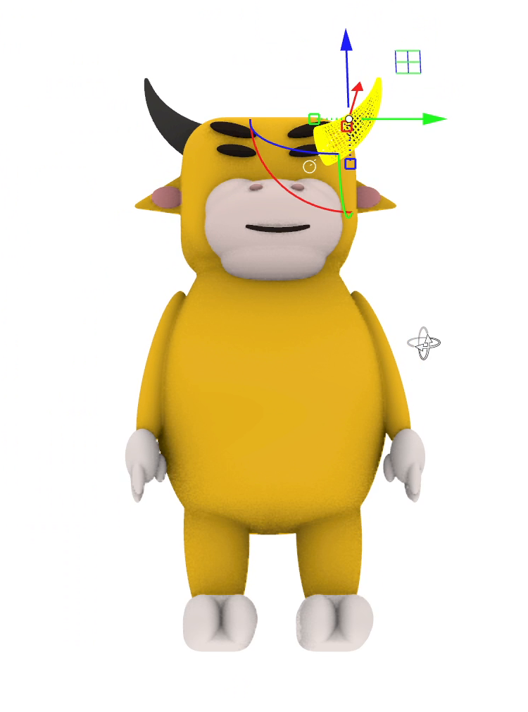

::: note
The cow took about **37 minutes** in total, including waiting, me giving feedback, and it redoing round after round. Honestly, after all that time, the result was still just so-so.
:::

## 05 Next, a spiral staircase

I remember a friend once asked me how to model a spiral staircase in Rhino without GH. It suddenly struck me that this really is a fairly common and rather tricky modeling problem, so I wanted to try it and see what the AI would come up with. At the time I gave only a very vague prompt, but you can give it a fuller, more precise description and see how it does.

::: prompt The prompt I used
open a new file and build a spiral staircase
:::

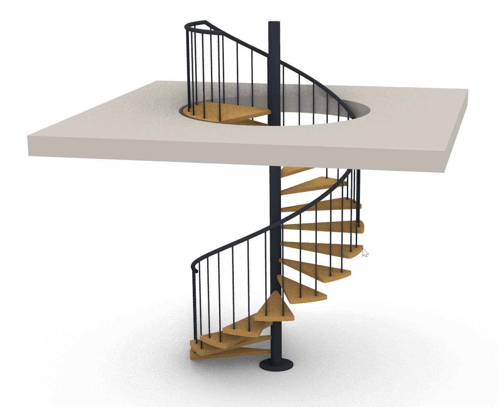

This round took about 19 minutes in total, including saving the previous file, generating the staircase and checking the result. The main body of the stair got built, and the materials and layers are sorted out properly. But near the landing, the railing is in the wrong place: once you walk up, it might block your way. How the stair meets the landing and how the floor opening is cut still need more work. Still, the AI has built most of it, and I feel some quick manual deleting and tweaking would take care of the rest. In real modeling work, this should still be quite useful.

## 06 Then Grasshopper: the first version was a mess

Once the staircase was done, I also wanted to change the floor height, number of steps and rotation angle. Re-describing everything in chat each time would still be a bit of a hassle. So I had it go further and make a **Grasshopper file**, wiring these parameters to sliders so I could just drag them and make changes myself.

The prompt I used at the time:  
*save this file first then build the spiral staircase in GH so I can adjust the parameters*

It did build all the components and wires. But my first look at the canvas gave me a bit of a headache: components crammed together, wires running from one side to the other. To find a parameter, you'd first have to work out where it was even placed.

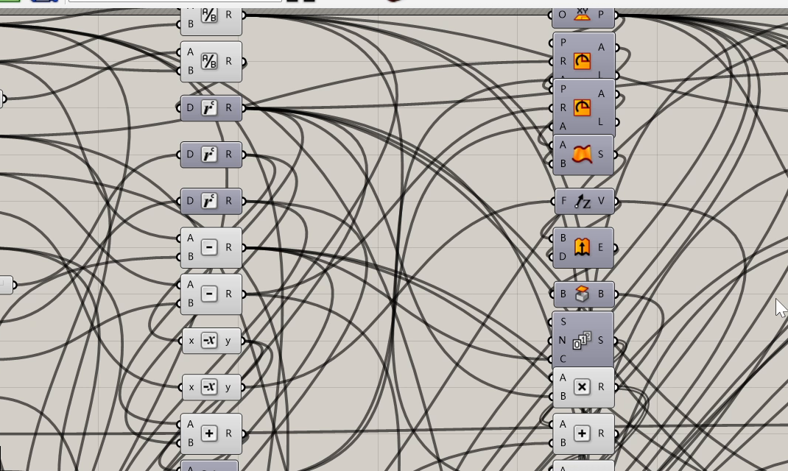

Layout aside, this version does work, and all the sliders are named, so it's easy to adjust. I changed the floor height, number of steps, total rotation angle and outer radius one by one, and watched the staircase in Rhino follow along each time, which shows this parametric setup is quite stable, with no major bugs.

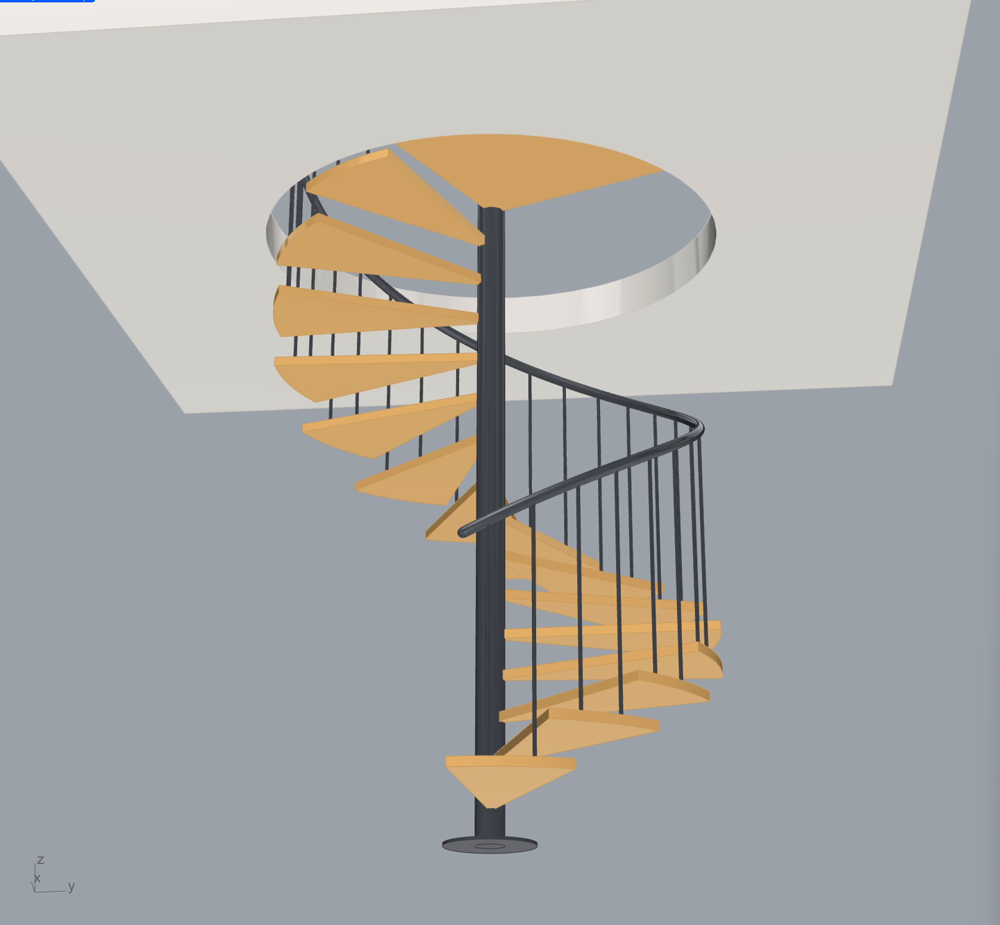

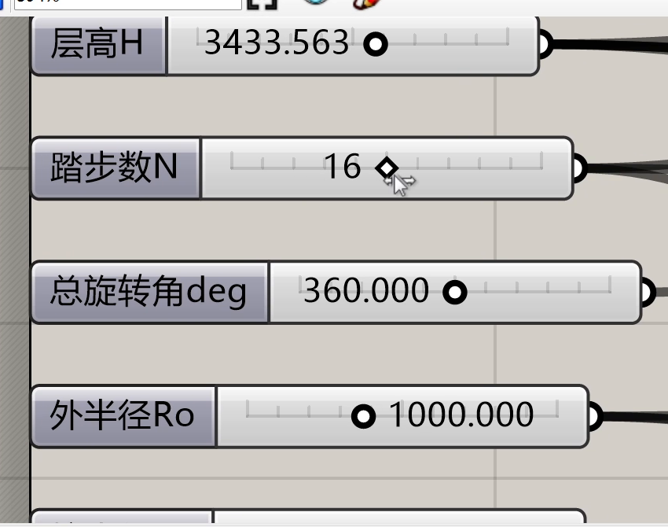

Once the parameters worked, I asked it to tidy up the canvas. Otherwise, if I opened it again in a few days, I'd probably have to read through the whole thing from scratch.

::: prompt The prompt I used
can you tidy up the gh file? right now it looks like a tangled mess
:::

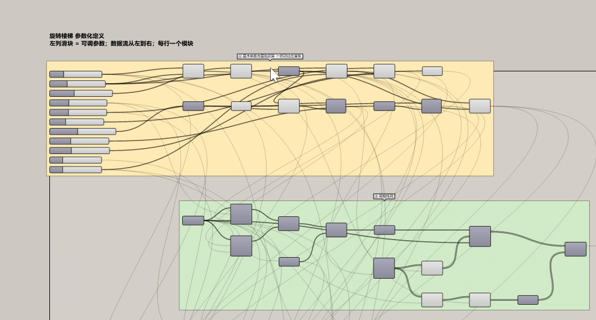

::: note
Generating the first version plus checking the parameters took about **9 minutes**. Tidying up the canvas alone took **more than 8 minutes** on top of that. That time has to be counted too.
:::

It's much clearer after the cleanup. This honestly blew me away, because it automatically organized everything into groups, wrote the annotations, and even changed how the wires are displayed. Some wires are shown lighter, which makes the whole canvas tidier, with a clear hierarchy. I think AI modeling really should be combined with GH; that's the more ideal setup. First, agents like Claude Code or Codex are better at programming, and GH is really just visual programming, so it comes more naturally to them. Second, with parametric control, the model you build can change to fit your needs, instead of burning lots of tokens over and over to revise a model built directly in Rhino.

## 07 Having it write a Game of Life in GH

Besides having the AI place components one by one, you can also have it write scripts directly inside a C# or Python component to implement more complex algorithms. I tried the classic "Game of Life" algorithm: each square in the grid represents a cell, and on each trigger, the next generation is computed from the states of the surrounding cells.

::: prompt The prompt I used
use the c# component in GH to write a Game of life, it needs to use persistent variables and use a trigger to fire evolve
:::

This time it used a C# component, with a button, a Boolean toggle and parameter sliders wired into it.

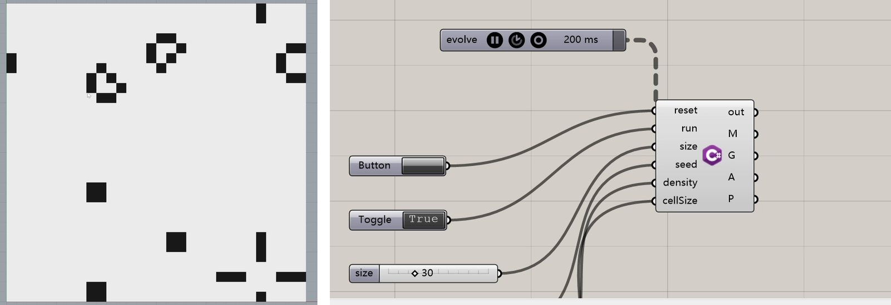

It took about **7 minutes** from starting to generate the script to finishing debugging, and the grid was up and running, and working well. I was amazed. Open the C# component and you can also see how the script inside handles initialization, each generation's computation, and the geometry output. For friends who want to learn scripting but aren't very familiar with it yet, small examples like this are good to take apart and study.

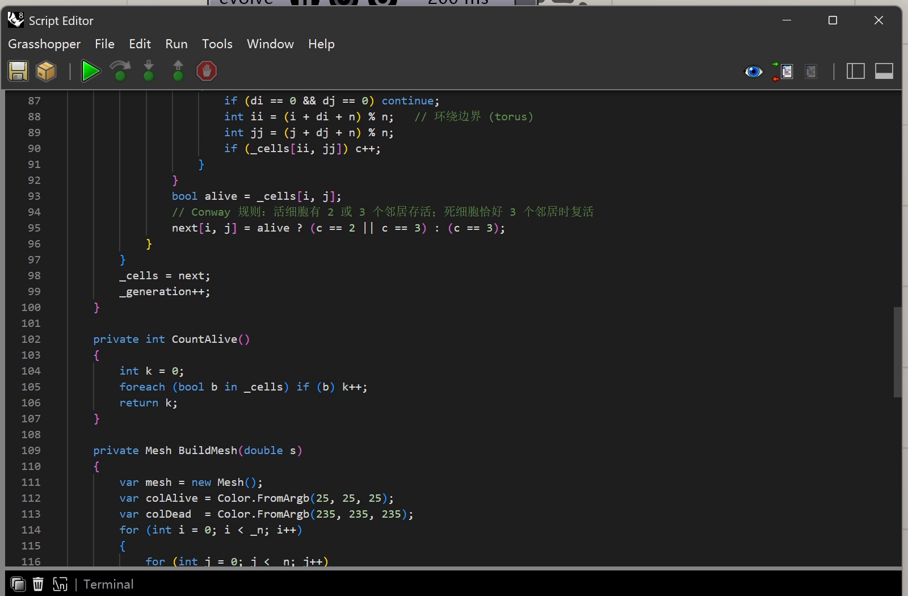

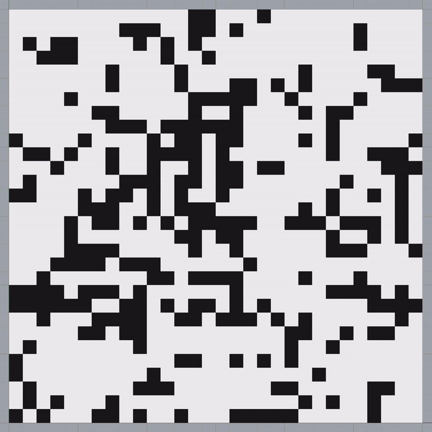

## In Part 2: trying a few other AIs

Of these examples, I think the kettle and the staircase can already serve as first drafts that I can then revise myself. The cow fell quite far short; for now, it isn't what I wanted. I think GH's parametrics and script components are the best way to use AI for modeling in Rhino.

In Part 2 I'll show Codex, which I also tried, as well as the Chinese models GLM and DeepSeek. I also installed a local model, but didn't manage to get it to finish the modeling. I'll share exactly where it got stuck too, for your reference.

### Official resources

- [Rhino MCP official installation and connection guide](https://mcneel.github.io/RhinoAI/docs/getting-started/cc-plugin/)
- [McNeel RhinoAI project and examples](https://github.com/mcneel/RhinoAI)
