Hello，朋友们！时过境迁，上次更新还是6年前。创建公众号之初，我在读本科，现在已经快博士毕业了。中途其实也做了一些知识分享，不过觉得视频的方式更加直观，所以在小破站上更新了一系列在 Rhino 里使用 C# 的视频。现在准备捡起公众号，继续写更多 blogs，但主要内容会从 GH 转向 coding + AI 方面的知识分享。

这里的文章，也主要会是我之后每期视频的精炼图文版本。我将借助 AI 的无上大法快速写文，所以有的部分难免带点 AI 的僵硬文气，不过为了快速传播知识，我觉得也未尝不可。

不多废话，这次主要想分享如何安装 Rhino MCP，让 AI Agent 帮我们在 Rhino 里建模。先讲怎么装，再用几个例子看看效果。我试了几个例子：照着照片建水壶、做《牛来》里的牛牛、生成旋转楼梯，用 Grasshopper 把楼梯做成可以调参数的模型。国内国外的 AI 都试了一下，包括 Claude Code、Codex、GLM 和 DeepSeek，最后还折腾了一下本地模型（不是很成功，本地部署还道阻且长）。大家可以自己比较一下效果。

内容比较多，分成上下两篇。上篇先讲安装和 Claude 的几个例子，下篇再看其他 AI。已经装好的朋友，可以直接跳到第三节看水壶。

## 01 先说一下 MCP 是干什么的

MCP 全称 Model Context Protocol，模型上下文协议。它其实是一套通信规则，让 AI Agent 可以和其他程序交流，从而控制其他程序做事。这套 Rhino 工作流会在本地启动一个服务（Server），通过本机地址，用类似访问网站的方式相互通信。如果你的 Rhino 是设置了防火墙进行的破解，使用这个功能就可能受限。AI Agent 和 Rhino 通过 MCP 这个桥梁连接后，Agent 可以直接调用 Rhino 的工具，读取当前模型、运行建模操作，还能切换视角、截图，再根据结果继续修改。我们在聊天窗口里提要求，模型就在 Rhino 里自动生成，省去大家的建模之苦了。

::: note
这里有三个东西容易混：基础大语言**模型**负责理解要求，AI **客户端**是我们发出指令、调用工具的地方，**Rhino** 用来建模。MCP 就是把它们接起来的桥梁。
:::

先准备好 **Rhino 8**。这里先用 **Claude Code** 中的 Fable 5／5.1 做演示，部分任务还开了 Ultracode 多智能体功能，也就是让几个 AI 分工处理。下面的耗时都是在这套设置下试出来的。

## 02 安装和连接

**第一步，安装 Rhino 插件。**  
在 Rhino 命令行输入 **PackageManager**，搜索 Rhino-MCP，找到 **Rhino-MCP-Platform**。这里注意一下，搜索结果里有名字很像的插件，要认准说明中的 **made by McNeel**。点击 Install，装好后重启 Rhino。

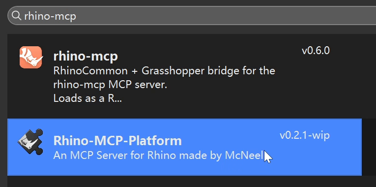

**第二步，连接 AI 客户端。**  
在 Rhino 命令行里输入 **MCPConnect**，窗口会列出检测到的客户端，点击对应的 Install 就可以配置。下面这张图里，Claude Code 已经显示 Installed，说明装好了；Codex 还没有装。

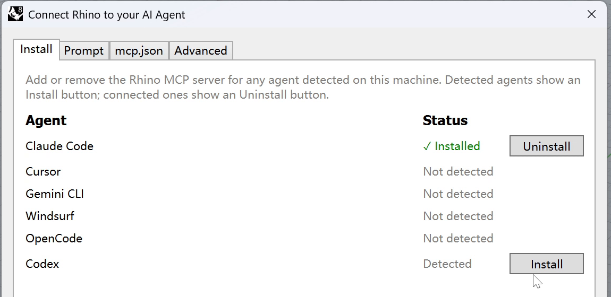

如果你的界面和这里不一样，没有 Install 页面，可以切到 Prompt，复制它生成的配置提示，发给要用的 AI 客户端，让它按提示配置，再重启客户端。版本更新后入口可能会变，文末放了官方说明。

**第三步，启动服务，试一下能不能连上。**  
回到 Rhino，在命令行输入 **MCPStart**，上方的日志（Log）里会显示 MCP Server 启动在哪个本地端口。把连接信息发给 AI，让它检查一下：

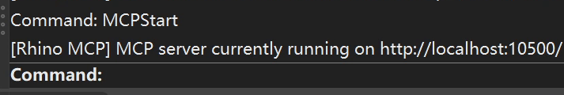

::: prompt 我用的 Prompt
MCP server currently running on http://localhost:10500/ 请帮我连接rhino mcp 并检查连接性
:::

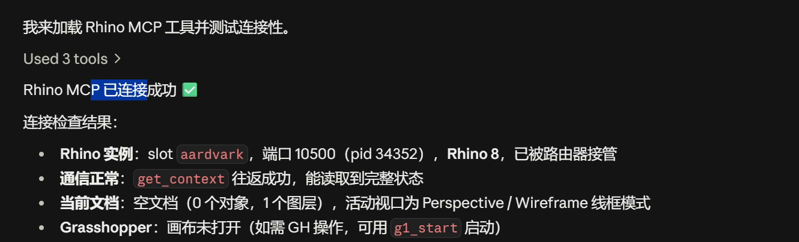

连上之后，可以先让它做一个小东西来测试一下。另外，可以输入 **MCPHelp** 打开官方文档，查阅说明和更新（可能需要爬墙）。

## 03 第一个例子：照着照片建水壶

先试一个水壶。我把 McNeel 官方示例里的玻璃电热水壶照片发给 Claude Code，要求就一句话：

::: prompt 我用的 Prompt
Model this image in Rhino
:::

我们看一下实际操作时的样子。左边开着 Rhino，右边是 Claude 的聊天和任务窗口。右边能看到它在分析什么、准备怎么建，左边能看到模型逐步生成。不需要把代码复制来复制去，建模操作由它自己调用。

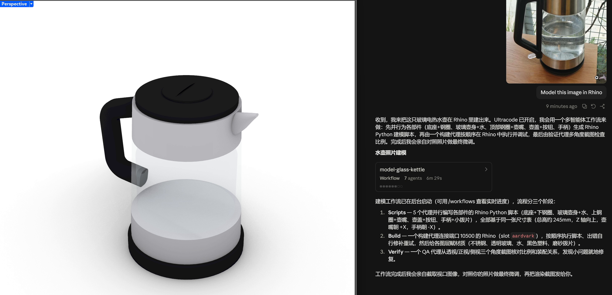

这一轮开了多智能体功能。它先看参考图，把水壶拆成壶身、底座、顶部、手柄等部分，再分别写 Rhino Python 脚本，运行之后生成几何体，最后换几个角度截图检查。等它运行的时候，也可以看看任务列表，有没有一开始就理解错的地方。

::: note
从发出要求，到开始查看完整的水壶主体，等了大约 **8–9 分钟**。加上后面换视角、调显示和检查结果，前后一共约 **14 分钟**。这里算的是我这一轮操作的时间，包括等待和检查。
:::

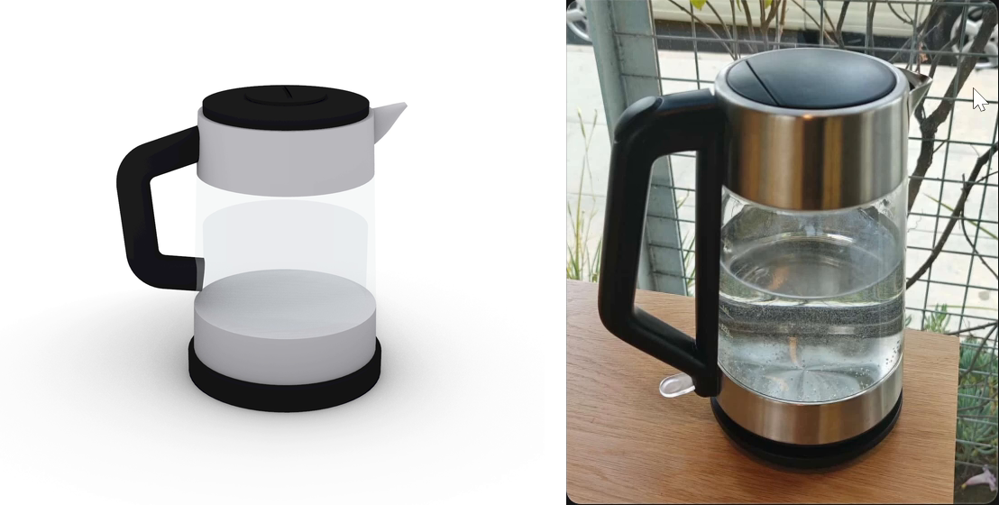

远看还可以，玻璃壶身、黑色手柄和底座都做出来了。但对着原图细看，手柄上下的宽度不对，按钮和一些局部比例也有偏差。不过完全解放双手的建模还是很快乐的。

朋友们可以试着继续改，只需把需求和问题描述清楚。如果只说一句“不像”，它也很难知道我们想改哪儿。模型已经分了图层，如果有些地方自己动手更快，也可以接着改。

## 04 牛来：折腾了半天，效果一般

水壶做完，我想整个活，就再试一个没那么规整的。正好当时《牛来》很火，我给了里面牛牛的参考图，让它照着建模。第一版出来，头、角和身体是都有了，但基本是球体、圆柱这些基础几何拼起来的。对着参考图看一下，造型还是差得挺远。

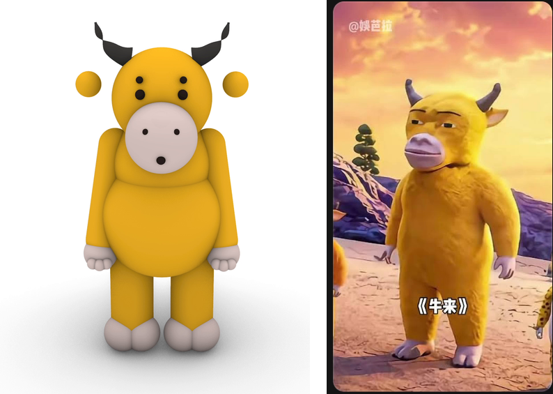

我接着让它用 SubD，想着把形状做得柔软一些。后面又改了好几轮，头、口鼻、眼睛、眉毛、手臂、肚子都动过。比最开始是有进步，但看起来还是差点火候，角色的神态也没做对。这说明模型的水平还是有限，也许 Codex 会表现更好。

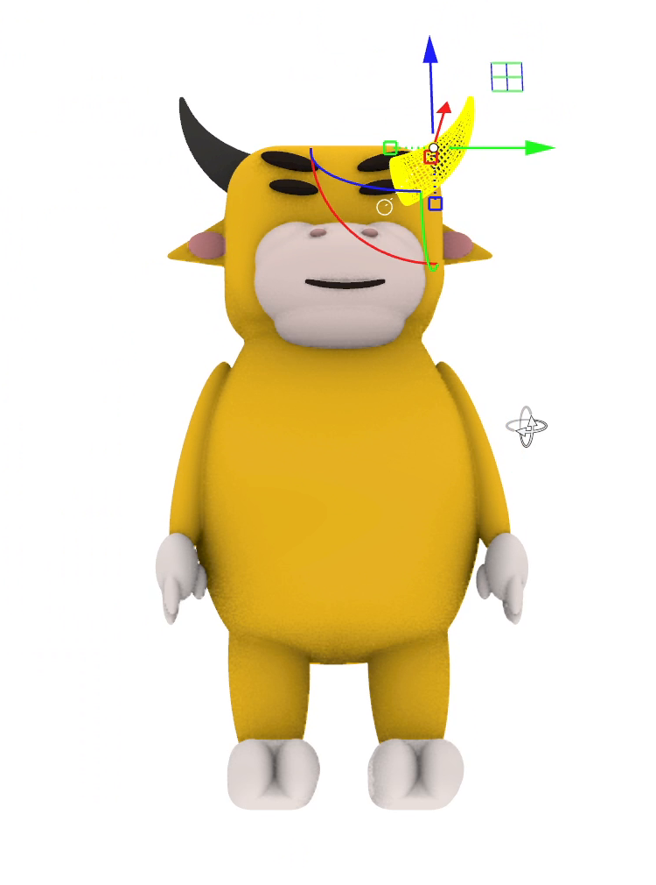

::: note
这个牛牛前后花了约 **37 分钟**，包括等待、我提修改意见，以及它一轮一轮重做。说实话，花了这么久，最后效果还是一般。
:::

## 05 再试一个旋转楼梯

记得从前有个朋友问我，不用 GH 的话，怎么在 Rhino 里建旋转楼梯。我突然觉得，这还真是个比较常见、又比较 tricky 的建模问题，于是想着试试看，AI 建出来会是什么效果。我当时只给了很笼统的提示词，不过大家可以给更多、更准确的描述，看看效果。

::: prompt 我用的 Prompt
新开文件建一个旋转楼梯
:::

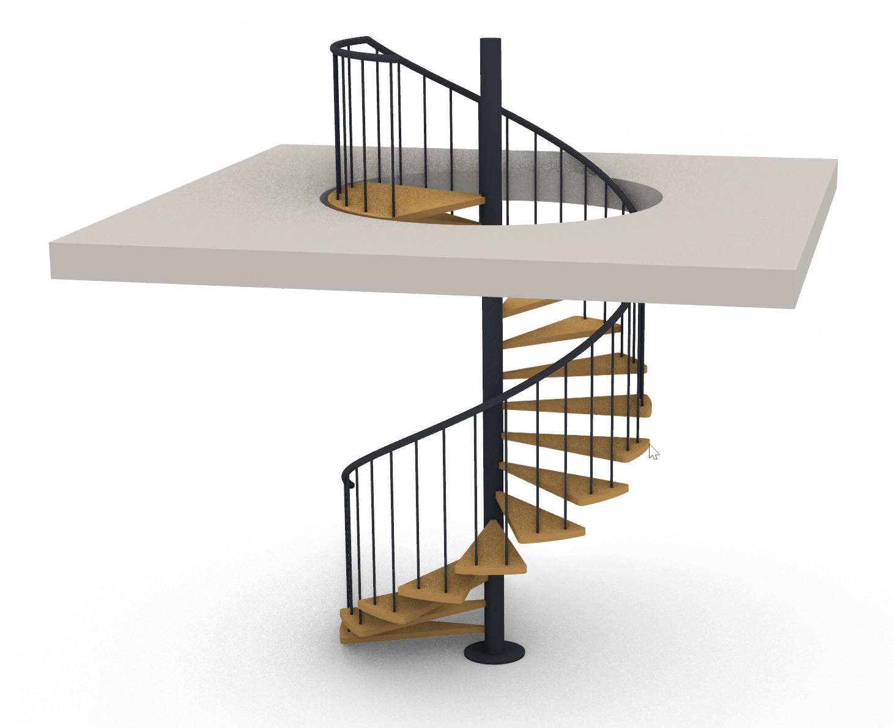

这一轮前后约 19 分钟，里面包括保存上一个文件、生成楼梯和检查结果。楼梯主体做出来了，材质和图层也分好了。不过看平台附近，栏杆的位置有问题，人上楼之后可能就被挡住了。楼梯和平台怎么接、楼板洞口开口方式，这些地方还要继续改。不过 AI 已经建了大部分，感觉手动快速删删改改也没问题了。在实际建模当中，应该还是很有用的。

## 06 接着试 Grasshopper，第一版很乱

楼梯做好之后，我还想改层高、踏步数和旋转角度。如果每次都在聊天里重新说一遍，还是有点麻烦。于是继续让它做成 **Grasshopper 文件**，把这些参数接到滑块上，之后就可以自己拖着改。

我当时用的 Prompt：  
*你把这个文件先存一下 然后用GH建旋转楼梯 这样我可以调整参数*

它确实把电池和连线都建出来了。但第一眼看到画布，有点头疼：电池挤在一起，线从这边跨到那边。想找一个参数，还得先研究一下它到底放在哪里。

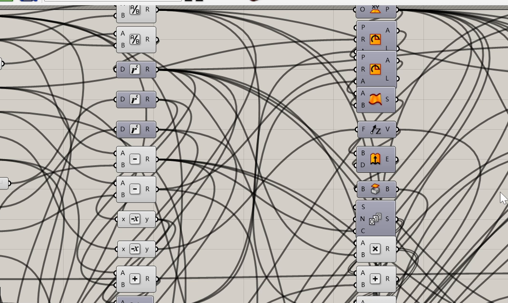

先不管排版，这一版确实能用，而且所有 sliders 都有名称，还是很好调整的。我依次改了层高、踏步数、总旋转角和外半径，观察到 Rhino 里的楼梯都跟着变，说明这个参数化控制流还是很稳定的，没有太大的 Bug。

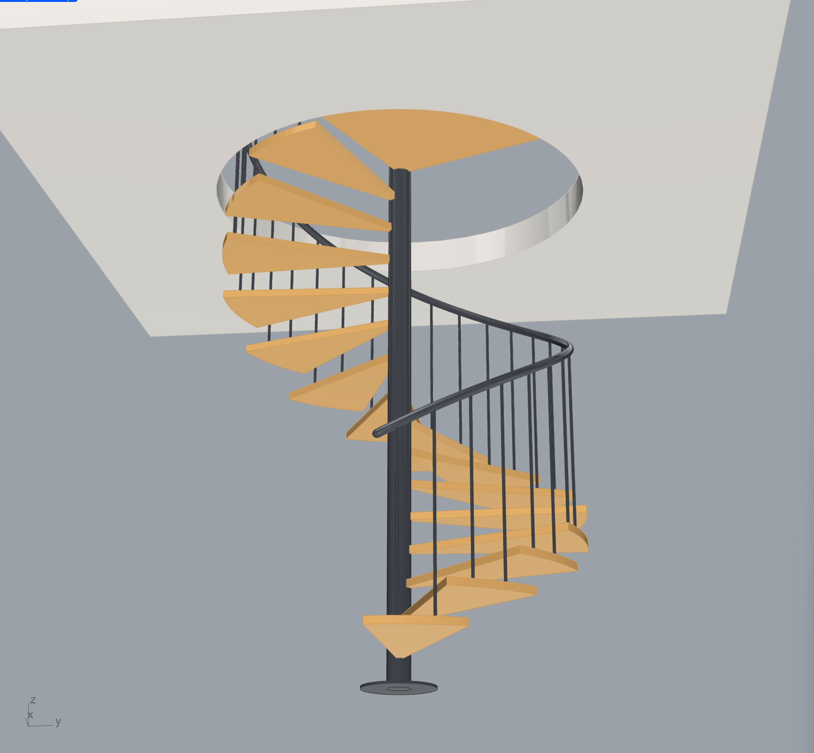

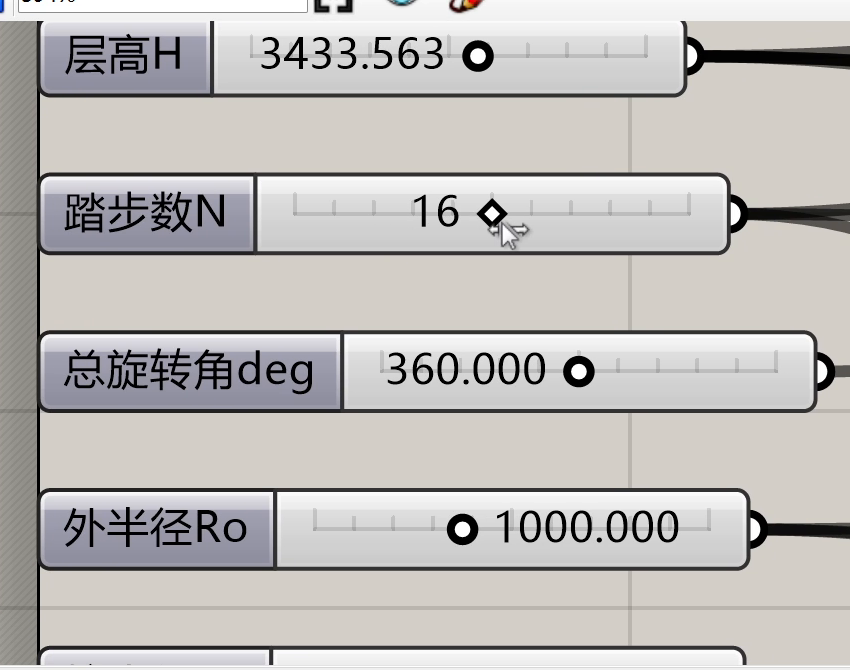

参数能动之后，我就让它整理一下画布。不然过几天再打开，恐怕又要从头看一遍。

::: prompt 我用的 Prompt
你能把gh文件整理一下嘛 现在看着一团乱麻
:::

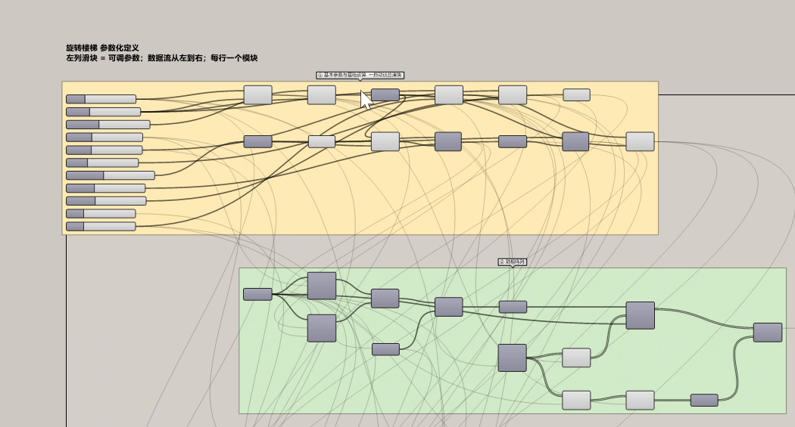

::: note
第一版生成加上参数检查，约 **9 分钟**。后面光是整理画布，又花了 **8 分钟以上**。这部分时间也得算进去。
:::

整理后清楚多了。这里让我很震惊，因为它自动地将每个组都打包好了，也写好了注释，甚至能改变连线的显示方式。有些线显示得更浅，这样让整个画布更加整洁，主次明显。我觉得，AI 建模还是应该与 GH 结合，这样比较理想。首先，像 Claude Code 或者 Codex 这些智能体更擅长编程，GH 其实就是图形化编程，所以它们做起来更加得心应手；其次，有参数控制，建出来的模型可以根据需求而改变，不会重复使用大量 tokens 来改一个直接在 Rhino 里建的模型。

## 07 让它在 GH 里写个生命游戏

除了让 AI 一个一个摆电池，还可以让它在 C# 或 Python 组件里直接写脚本，实现更加复杂的算法。我试了经典的算法“生命游戏”（Game of Life）：网格里的每个格子代表一个细胞，每次触发，根据周围细胞的状态计算下一代。

::: prompt 我用的 Prompt
你使用GH中的c#元件写一个Game of life 需要使用persistent variables 并使用trigger激发evolve
:::

这次它用的是 C# 组件，外面接按钮、布尔开关和参数滑块。

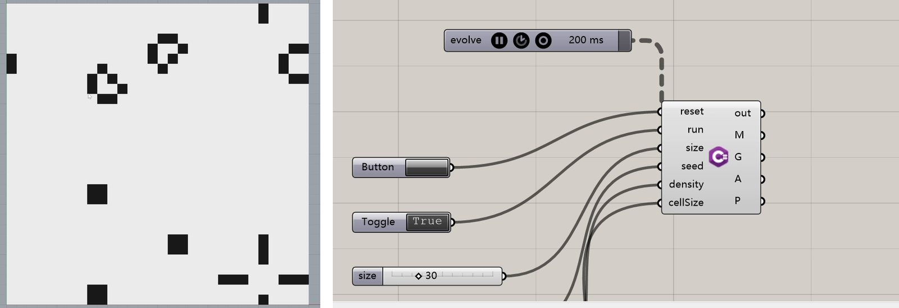

从开始生成脚本到调试好，约 **7 分钟**，网格就跑起来了，而且运行良好，我很惊叹。打开 C# 组件，也可以看到内部 Script 的初始化、每一代的计算和几何输出分别是怎么写的。对想学脚本但还不太熟的朋友，这种小例子也可以拿来拆着看。

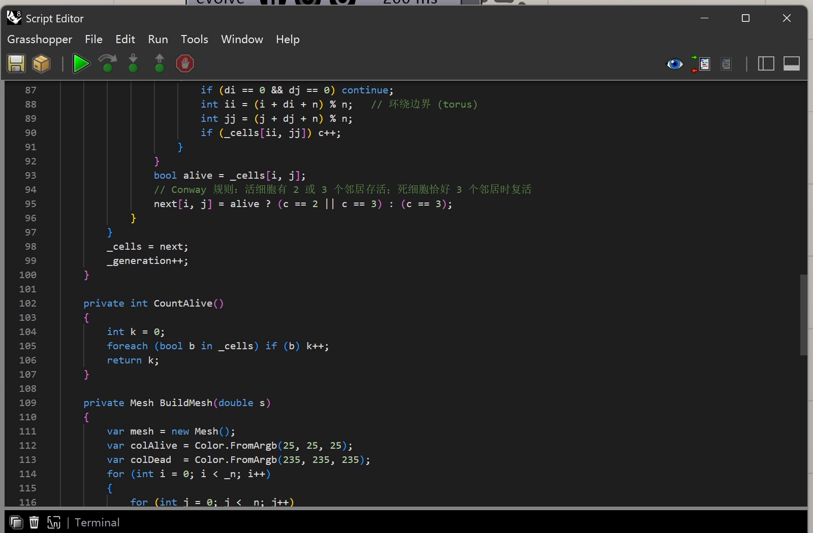

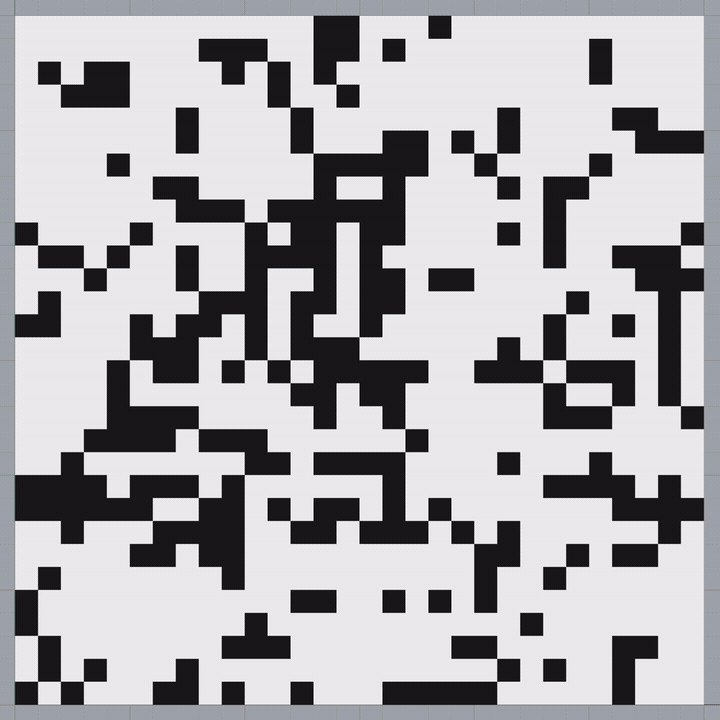

## 下篇再换几种 AI 试试

这几个例子里，我觉得水壶和楼梯已经可以拿来做初稿，后面再自己改。牛牛就差得比较多，暂时没有达到我想要的效果。我觉得，GH 的参数化和脚本组件，是使用 AI 在 Rhino 里建模的最佳方式。

下篇展示一下我试过的 Codex，以及国产大模型 GLM 和 DeepSeek。本地模型我也装了，不过没有成功让它完成建模，具体卡在哪里，也一起放出来，供大家参考。

### 官方资料

- [Rhino MCP 官方安装与连接说明](https://mcneel.github.io/RhinoAI/docs/getting-started/cc-plugin/)
- [McNeel RhinoAI 项目与示例](https://github.com/mcneel/RhinoAI)
